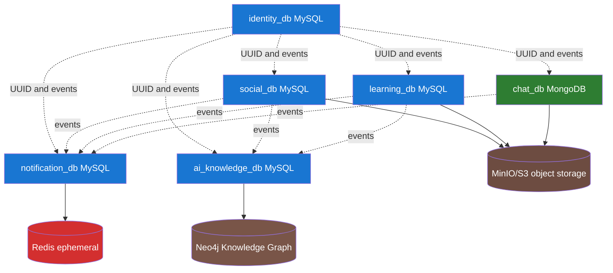

# Thiết kế Database — Tổng quan và Quy ước

## Mục đích và trạng thái

Đây là **logical/physical database design đề xuất để duyệt trước khi code**. Nó được suy ra từ giao diện cập nhật tại `design/exports/html-tailwind`, `design/exports/admin`, bộ spec hiện có và quyết định kiến trúc `Cấu trúc cuối cùng.md`.

Không có migration, model, database hay connection thực tế nào trong repository tại thời điểm viết. Vì vậy mọi bảng/cột dưới `docs/database/` là `PROPOSED`, không phải `VERIFIED_IMPLEMENTED`. Sau khi chủ dự án duyệt, mỗi service chỉ tạo migration cho phần vertical slice được triển khai.

## Nguồn bằng chứng chính

| Nhóm dữ liệu | UI/tài liệu cho thấy |
| --- | --- |
| Identity/RBAC | `04-register.html`, `06-profile.html`, Admin 02 User Management, Admin 03 Department Roles |
| Social/News/Moderation | `03-social-feed.html`, `03b-social-news.html`, `06b-social-profile.html`, Admin 04 Post Moderation |
| Documents/Q&A/Reward | `08*`, `09*`, `10*`, `11*`, `12-leaderboard.html`, Admin 05–06 |
| Chat/Notification | `05-messenger.html`, `01-welcome.html`, Admin 04 |
| AI/KG/Search/Audit | `14*`, `15*`, Admin 07–08; `08-ai-knowledge-spec.md` |

## Kiến trúc dữ liệu bắt buộc

| Database / store | Owner | Nguồn dữ liệu chính | Không được chứa |
| --- | --- | --- | --- |
| `identity_db` | Identity Service | Organization, employee account/profile, department, RBAC, credential/session, central audit projection | Social/Learning/Chat content |
| `social_db` | Social Service | Channels, posts/news/events, comments, reactions, saves, reports | Password, Learning Q&A, Chat messages |
| `learning_db` | Learning Service | Taxonomy, Q&A, answers, documents/versions/access, courses, reward ledger | Password, graph nodes as source of truth |
| `chat_db` | Chat Service | Conversations, members, messages, read state | Account credentials, durable notification history |
| `notification_db` | Notification Service | In-app/push/email delivery, broadcasts and preferences | Source post/message/document content |
| `ai_knowledge_db` | AI Knowledge Service | Ingestion/run/chunk/proposal/curation/index metadata, risk assessment, expertise projection | Original authorization truth or secret values |
| Neo4j | AI Knowledge Service | Curated graph projection and graph queries | Authoritative document/user/account source records |
| Redis | Infrastructure/shared technical service | Cache, rate-limit, presence, lock, short-lived realtime state | Durable business data |
| Object Storage | Source owner via service | Binary file objects, private object keys | Password/secret/API key in object metadata |

## Quy ước chung cho MySQL

| Quy ước | Quy định đề xuất |
| --- | --- |
| Engine/charset | MySQL 8+, InnoDB, `utf8mb4`, collation case-insensitive phù hợp tiếng Việt. |
| ID | Business/public IDs dùng `CHAR(36) CHARACTER SET ascii` UUIDv7. API/event truyền canonical UUID string. Không dùng auto-increment làm ID xuyên service. |
| Tenant/organization | Các bảng có dữ liệu doanh nghiệp cần `organization_id CHAR(36)`. Dù bản đầu chỉ có một công ty, giữ cột này để isolation, unique constraint và audit rõ ràng. |
| Time | `DATETIME(6)` lưu UTC; application chỉ đổi timezone ở biên hiển thị. Dùng tên `*_at`. |
| Soft delete | Các entity user-facing có lifecycle dùng `deleted_at`; log, outbox, ledger và audit immutable không soft-delete. |
| Status/type | Dùng `VARCHAR(32)`/`VARCHAR(64)` với application validation hoặc lookup table thay vì MySQL `ENUM`, trừ giá trị thật sự không thay đổi. |
| Money/reward | Points/coins dùng `BIGINT` integer, không dùng float. `DECIMAL(19,4)` chỉ khi có giá trị tiền tệ đã được phê duyệt. UI có `$` nhưng không phải bằng chứng cho monetary ledger. |
| JSON | Chỉ dùng `JSON` cho payload mở rộng/metadata có schema version. Không dùng JSON thay bảng có quan hệ, filter hoặc unique constraint. |
| File | DB chỉ lưu object key, checksum, MIME, size, scan state; binary nằm ở MinIO/S3. |
| Secret | Không lưu password plaintext, session token plaintext, API key/Neo4j password/model provider key trong database. Dùng `secret_ref` trỏ secret manager/config runtime. |
| FK | FK bắt buộc trong cùng database khi relation bền vững và không tạo vòng đời khó deploy. Không FK/join xuyên service database. |
| Index | Mọi query list phải có composite index bắt đầu bằng `organization_id`, sau đó scope/filter/sort thực tế. Index không thay thế phân quyền. |

## Cột chuẩn

Trừ khi bảng ghi khác, bảng mutable có:

| Column | Type | Null | Mô tả |
| --- | --- | --- | --- |
| `id` | `CHAR(36)` | No | UUIDv7 primary key. |
| `organization_id` | `CHAR(36)` | No | Tenant/company boundary; FK nội bộ đến organization khi cùng `identity_db`, còn service khác chỉ là UUID reference. |
| `created_at` | `DATETIME(6)` | No | UTC creation time. |
| `updated_at` | `DATETIME(6)` | No | UTC last mutable update. |
| `deleted_at` | `DATETIME(6)` | Yes | Chỉ khi entity hỗ trợ soft delete. |

Không thêm `created_by`/`updated_by` máy móc. Khi actor có ý nghĩa nghiệp vụ hoặc audit, dùng `created_by_user_id`, `updated_by_user_id` và audit event.

## Quy tắc reference liên service

1. `user_id`, `author_user_id`, `reviewer_user_id`, `organization_id`, `org_unit_id` ở database không sở hữu là **UUID reference, không FK**.
2. Consumer cần display name/avatar/department nhanh có thể giữ read model tối thiểu, có `source_version`/`synced_at`; không copy PII không cần thiết.
3. Mọi thay đổi quan trọng phát qua outbox event. Consumer ghi `processed_events` để idempotent.
4. Gateway/Admin muốn màn hình tổng hợp phải gọi owner API hoặc đọc một projection được duyệt; không query trực tiếp database service khác.

## Phân loại dữ liệu

| Level | Ví dụ | Chính sách tối thiểu |
| --- | --- | --- |
| Public internal | Tin công ty được toàn công ty xem | Authenticated-only, audit thao tác admin. |
| Internal | Feed, Q&A, tài liệu thông thường | Organization/department authorization; no public link. |
| Restricted | Tài liệu phòng ban, chat nhóm dự án | Explicit role/org-unit/membership policy; private object access. |
| Confidential | HR, secret/security incident, tài liệu R&D mật | Need-to-know ACL, encrypted storage where required, audited access, excluded from AI until approved. |
| Security secret | Password hash, session token hash, device token, provider key | Secret handling, redaction, strict retention; never expose in UI/log/audit payload. |

## Review order

1. Duyệt ownership và ranh giới database ở file này.
2. Duyệt Identity/RBAC trước vì mọi service khác dùng user/org reference.
3. Duyệt Learning reward/document confidentiality trước AI/KG.
4. Duyệt Social/Chat/Notification policy rồi mới viết API/migration.
5. Chốt mục `Needs Decision` trong [10-open-decisions.md](10-open-decisions.md) trước khi sinh schema thật.
