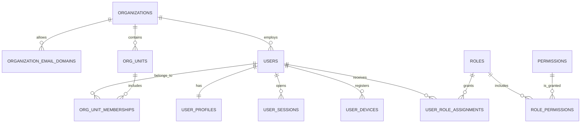

# Identity Service — `identity_db` MySQL

## Trách nhiệm

Identity Service sở hữu tài khoản nhân sự, thông tin hồ sơ, cấu trúc phòng ban, RBAC, credential/session và projection audit phục vụ Admin. Nó là nguồn sự thật về `user_id`, role và permission; các service khác chỉ lưu UUID/read model tối thiểu.

## Sơ đồ quan hệ

## Core organization and hierarchy

### `organizations`

| Column | Type | Null | Default | Constraints / description |
| --- | --- | --- | --- | --- |
| `id` | `CHAR(36)` | No | — | PK UUIDv7. |
| `legal_name` | `VARCHAR(255)` | No | — | Legal organization name. |
| `display_name` | `VARCHAR(255)` | No | — | UI name, e.g. NovaTech. |
| `primary_domain` | `VARCHAR(253)` | No | — | Normalized lowercase email domain; unique. |
| `timezone` | `VARCHAR(64)` | No | `Asia/Bangkok` | IANA zone used for display/reporting. |
| `status` | `VARCHAR(32)` | No | `active` | `active`, `suspended`, `archived`. |
| `logo_object_key` | `VARCHAR(512)` | Yes | — | Private/public logo object reference, not binary. |
| timestamps | standard | No | — | No soft delete; archive through status. |

Indexes: `UNIQUE(primary_domain)`, `INDEX(status)`.

### `organization_email_domains`

| Column | Type | Null | Default | Constraints / description |
| --- | --- | --- | --- | --- |
| `id` | `CHAR(36)` | No | — | PK. |
| `organization_id` | `CHAR(36)` | No | — | FK `organizations.id`. |
| `domain` | `VARCHAR(253)` | No | — | Lowercase domain without `@`. |
| `is_verified` | `BOOLEAN` | No | `false` | Domain verified by owner/admin. |
| `allow_self_registration` | `BOOLEAN` | No | `false` | Must be approved before public-internal register flow. |
| timestamps | standard | No | — | — |

Indexes: `UNIQUE(organization_id, domain)`, `UNIQUE(domain)` if one organization per installation.

### `org_units`

Represents divisions, departments and teams shown in Admin 03. Hierarchy is adjacency-list; do not use a fixed `department/team` column because UI already shows multiple levels.

| Column | Type | Null | Default | Constraints / description |
| --- | --- | --- | --- | --- |
| `id` | `CHAR(36)` | No | — | PK. |
| `organization_id` | `CHAR(36)` | No | — | FK. |
| `parent_id` | `CHAR(36)` | Yes | — | Self-FK. Null for root unit. |
| `code` | `VARCHAR(64)` | No | — | Stable code, e.g. `TECH-RD`, normalized uppercase. |
| `name` | `VARCHAR(255)` | No | — | Display name. |
| `unit_type` | `VARCHAR(32)` | No | `department` | `division`, `department`, `team`, `project`. |
| `description` | `TEXT` | Yes | — | Responsibility description from Admin modal. |
| `manager_user_id` | `CHAR(36)` | Yes | — | Same-service user reference; validate in application to avoid hierarchy/user lifecycle cycle. |
| `status` | `VARCHAR(32)` | No | `active` | `active`, `inactive`, `archived`. |
| `sort_order` | `INT UNSIGNED` | No | `0` | Deterministic sidebar/tree order. |
| timestamps / `deleted_at` | standard | — | — | Soft delete only after members moved. |

Indexes: `UNIQUE(organization_id, code)`, `INDEX(organization_id, parent_id, status, sort_order)`, `INDEX(manager_user_id)`.

## Account and profile

### `users`

`users` là security/account record. Theo phạm vi đã chốt, password và metadata đăng nhập nằm ngay trên bảng này; không dùng bảng credential, identity hoặc activation riêng. Dữ liệu trình bày/PII của hồ sơ nằm trong `user_profiles`.

| Column | Type | Null | Default | Constraints / description |
| --- | --- | --- | --- | --- |
| `id` | `CHAR(36)` | No | — | PK; canonical cross-service `user_id`. |
| `organization_id` | `CHAR(36)` | No | — | FK organization. |
| `employee_code` | `VARCHAR(64)` | No | — | Normalized employee/staff ID, e.g. `NV-2026-089`; not UI decoration. |
| `email` | `VARCHAR(254)` | No | — | Original canonical company email. |
| `email_normalized` | `VARCHAR(254)` | No | — | Lowercase/trimmed lookup key. |
| `email_verified_at` | `DATETIME(6)` | Yes | — | Chỉ ghi khi email đã được Admin/import policy xác nhận. |
| `account_status` | `VARCHAR(32)` | No | `active` | `active`, `locked`, `suspended`, `terminated`. |
| `employment_status` | `VARCHAR(32)` | No | `active` | `active`, `on_leave`, `inactive`, `terminated`; distinct from account security state. |
| `primary_org_unit_id` | `CHAR(36)` | Yes | — | FK `org_units.id`; must match an active membership. |
| `job_title` | `VARCHAR(255)` | Yes | — | Current job title from registration/admin UI. |
| `password_hash` | `VARCHAR(255)` | No | — | Argon2id/bcrypt hash only; never plaintext. |
| `password_changed_at` | `DATETIME(6)` | No | — | Password-age policy/audit. |
| `must_change_password` | `BOOLEAN` | No | `false` | True only for approved temporary-password flow. |
| `password_version` | `INT UNSIGNED` | No | `1` | Increment to invalidate active sessions after change. |
| `login_provider` | `VARCHAR(64)` | No | `local` | Current value is `local`; kept here only if one external provider is added later. |
| `external_subject` | `VARCHAR(255)` | Yes | — | Optional stable subject of that future provider; no separate identity table in this scope. |
| `last_login_at` | `DATETIME(6)` | Yes | — | Successful interactive login. |
| `failed_login_count` | `SMALLINT UNSIGNED` | No | `0` | Security counter, reset on success. |
| `locked_until` | `DATETIME(6)` | Yes | — | Temporary lock expiry. |
| `deactivated_at` | `DATETIME(6)` | Yes | — | Account deactivation timestamp. |
| timestamps / `deleted_at` | standard | — | — | Never hard delete a user while referenced by audit/business data. |

Indexes: `UNIQUE(organization_id, employee_code)`, `UNIQUE(organization_id, email_normalized)`, `UNIQUE(login_provider, external_subject)`, `INDEX(organization_id, account_status, primary_org_unit_id)`, `INDEX(locked_until)`. MySQL permits multiple `NULL` values in the optional external-subject unique index.

### `user_profiles`

| Column | Type | Null | Default | Constraints / description |
| --- | --- | --- | --- | --- |
| `user_id` | `CHAR(36)` | No | — | PK + FK `users.id`; one profile/account. |
| `full_name` | `VARCHAR(255)` | No | — | Required UI name. |
| `display_name` | `VARCHAR(255)` | Yes | — | Optional shorter social display. |
| `phone_e164` | `VARCHAR(32)` | Yes | — | Normalize to E.164, do not store presentation spaces. |
| `birth_date` | `DATE` | Yes | — | PII; restrict visibility. |
| `gender` | `VARCHAR(32)` | Yes | — | `male`, `female`, `other`, `prefer_not_to_say`; do not use free text. |
| `address_text` | `VARCHAR(500)` | Yes | — | PII; Profile UI input. |
| `hometown_text` | `VARCHAR(255)` | Yes | — | Optional Social profile display. |
| `avatar_object_key` | `VARCHAR(512)` | Yes | — | Object key only. |
| `avatar_mime_type` | `VARCHAR(100)` | Yes | — | Verified MIME, not client filename extension. |
| `avatar_size_bytes` | `INT UNSIGNED` | Yes | — | Enforce 5 MB UI policy at service. |
| `profile_visibility` | `VARCHAR(32)` | No | `organization` | `organization`, `restricted`; exact options need approval. |
| timestamps | standard | No | — | — |

### `org_unit_memberships`

| Column | Type | Null | Default | Constraints / description |
| --- | --- | --- | --- | --- |
| `id` | `CHAR(36)` | No | — | PK. |
| `organization_id` | `CHAR(36)` | No | — | FK. |
| `user_id` | `CHAR(36)` | No | — | FK users. |
| `org_unit_id` | `CHAR(36)` | No | — | FK org_units. |
| `membership_role` | `VARCHAR(32)` | No | `member` | `member`, `lead`, `manager`. Not system RBAC. |
| `is_primary` | `BOOLEAN` | No | `false` | Application/transaction ensures exactly one active primary unit when required. |
| `starts_at` | `DATETIME(6)` | No | — | Membership effective time. |
| `ends_at` | `DATETIME(6)` | Yes | — | Null when active. |
| timestamps | standard | No | — | — |

Indexes: `UNIQUE(user_id, org_unit_id, starts_at)`, `INDEX(organization_id, org_unit_id, ends_at)`, `INDEX(user_id, ends_at, is_primary)`.

## Authentication and device security

### `user_sessions` and `user_devices`

`user_sessions` stores a hash/reference to refresh/session token, never raw token. `user_devices` supports first/new-device alert and push linkage.

| Table | Essential columns | Required indexes / rules |
| --- | --- | --- |
| `user_sessions` | `id`, `user_id`, `session_token_hash`, `auth_method`, `device_id`, `ip_hash`, `user_agent`, `issued_at`, `expires_at`, `revoked_at`, `revoke_reason`, timestamps | `UNIQUE(session_token_hash)`; `INDEX(user_id, revoked_at, expires_at)`; hash IP if full IP not needed. |
| `user_devices` | `id`, `user_id`, `device_fingerprint_hash`, `platform`, `device_name`, `first_seen_at`, `last_seen_at`, `is_trusted`, `revoked_at`, timestamps | `UNIQUE(user_id, device_fingerprint_hash)`; do not use fingerprint as a sole security factor. |

## RBAC

### `roles`, `permissions`, `role_permissions`, `user_role_assignments`

| Table | Essential columns | Constraints / purpose |
| --- | --- | --- |
| `roles` | `id`, `organization_id`, `code`, `name`, `description`, `is_system`, `status`, timestamps | `UNIQUE(organization_id, code)`; UI roles include Super Admin, Q&A Expert, HR Manager, Team Leader, Member. |
| `permissions` | `id`, `code`, `module`, `action`, `description`, `risk_level`, timestamps | Globally versioned permission codes, e.g. `users.manage`, `posts.pin`, `qa.best_answer.approve`. `UNIQUE(code)`. |
| `role_permissions` | `role_id`, `permission_id`, `granted_at`, `granted_by_user_id` | Composite PK/unique `(role_id, permission_id)`. |
| `user_role_assignments` | `id`, `organization_id`, `user_id`, `role_id`, `scope_type`, `scope_id`, `starts_at`, `ends_at`, `assigned_by_user_id`, timestamps | Scope supports `organization`, `org_unit`, `channel`, `topic`; scope is application-validated UUID/reference. `INDEX(user_id, starts_at, ends_at)`. |

Do not represent RBAC as a comma-separated role column on `users`. Do not use job title as permission.

## Admin support and audit projection

### `user_import_jobs` and `user_import_rows`

| Table | Essential columns | Purpose |
| --- | --- | --- |
| `user_import_jobs` | `id`, `organization_id`, `object_key`, `source_filename`, `format`, `status`, `total_rows`, `accepted_rows`, `rejected_rows`, `created_by_user_id`, `started_at`, `completed_at`, `error_summary`, timestamps | Excel/CSV import tracking, not user data source itself. |
| `user_import_rows` | `id`, `job_id`, `row_number`, `employee_code`, `email_normalized`, `validation_status`, `error_code`, `error_message`, `resolved_user_id`, `raw_row_redacted_json`, timestamps | Per-row result; retain for limited policy duration. |

### `organization_settings`

| Column | Type | Null | Description |
| --- | --- | --- |
| `organization_id` | `CHAR(36)` | No | FK / part of key. |
| `setting_key` | `VARCHAR(128)` | No | Non-secret, versioned setting name. |
| `setting_value_json` | `JSON` | No | Typed non-secret value only. |
| `updated_by_user_id` | `CHAR(36)` | Yes | Admin actor. |
| `updated_at` | `DATETIME(6)` | No | — |

PK: `(organization_id, setting_key)`. Examples: display name, allowed UI theme, feature flag. **Do not place** Neo4j password or AI provider key here; store a `secret_ref` outside DB config only when needed.

### `audit_events` — central read projection, not a cross-service source table

| Column | Type | Null | Description |
| --- | --- | --- |
| `id` | `CHAR(36)` | No | Audit event ID / PK. |
| `organization_id` | `CHAR(36)` | No | Tenant scope. |
| `occurred_at` | `DATETIME(6)` | No | When action happened. |
| `received_at` | `DATETIME(6)` | No | When central projection received it. |
| `source_service` | `VARCHAR(64)` | No | Producer owner. |
| `actor_type` / `actor_user_id` | `VARCHAR(32)` / `CHAR(36)` | No/Yes | `user`, `system`, `ai_worker`; actor optional for system. |
| `action_code` | `VARCHAR(128)` | No | e.g. `CREATE_USER`, `AUTO_BLOCK_POST`. |
| `target_type` / `target_id` | `VARCHAR(64)` / `CHAR(36)` | No/Yes | Resource reference, no FK across service. |
| `module` | `VARCHAR(64)` | No | Admin filtering. |
| `outcome` | `VARCHAR(32)` | No | `success`, `failure`, `blocked`. |
| `risk_level` | `VARCHAR(16)` | No | `normal`, `medium`, `high`, `critical`. |
| `correlation_id` | `CHAR(36)` | Yes | Trace across Gateway/services. |
| `ip_hash` / `device_summary` | `VARCHAR(128)` / `VARCHAR(255)` | Yes | Privacy-safe forensic data. |
| `metadata_redacted_json` | `JSON` | Yes | No password, token, secret, raw document or key. |

Indexes: `INDEX(organization_id, occurred_at DESC)`, `INDEX(organization_id, actor_user_id, occurred_at DESC)`, `INDEX(organization_id, module, risk_level, occurred_at DESC)`, `INDEX(correlation_id)`.

## Identity invariants to approve

1. `employee_code` and normalized email are unique inside an organization.
2. An active account must have a non-empty password hash and at least one active org-unit membership if organization policy requires it.
3. A locked/suspended/terminated account cannot receive a new session or new push notification.
4. Only Identity changes role assignments, account states and credentials.
5. Profile email edit must be policy-controlled; it cannot silently bypass allowed-domain/HR rules.
6. UI password defaults shown in HTML are demo content only and must never be seeded or documented as production credentials.

## Evidence

- `design/exports/html-tailwind/02-login.html`, `04-register.html`, `06-profile.html`
- `design/exports/admin/02-user-management.html`, `03-department-roles.html`, `07-system-audit-logs.html`, `08-system-settings.html`
- `Cấu trúc cuối cùng.md`, sections 4–7
