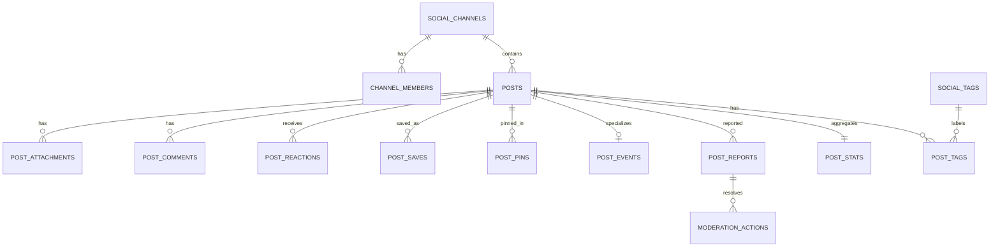

# Social Service — `social_db` MySQL

## Trách nhiệm

Social Service sở hữu Bảng tin Inside: kênh nội bộ, post cập nhật/news/announcement/event, comment, reaction, save, follow, report và moderation của **Social content**. `author_user_id`, `org_unit_id` và role là UUID/reference từ Identity, không có foreign key sang `identity_db`.

Màn Admin có hàng đợi moderation chung cho Inside/Square. Social chỉ lưu case/action cho post/comment của chính nó. Learning và AI giữ case/risk của dữ liệu mình; Gateway/Admin tổng hợp bằng API/event projection, không tạo một bảng cross-database dùng chung.

## Sơ đồ quan hệ chính

## Channels, news categories and social profile links

### `social_channels`

The feed UI shows company navigation and channels such as department/project channels. A channel is a content scope, not a database tenant.

| Column | Type | Null | Default | Constraints / description |
| --- | --- | --- | --- | --- |
| `id` | `CHAR(36)` | No | — | PK. |
| `organization_id` | `CHAR(36)` | No | — | Organization UUID reference. |
| `parent_channel_id` | `CHAR(36)` | Yes | — | Self-FK for nested channels when needed. |
| `org_unit_id` | `CHAR(36)` | Yes | — | Identity org-unit reference for department channel. |
| `code` | `VARCHAR(80)` | No | — | Stable slug, e.g. `tech-backend-core`; unique per organization. |
| `name` | `VARCHAR(255)` | No | — | Display name. |
| `description` | `TEXT` | Yes | — | Channel purpose. |
| `channel_type` | `VARCHAR(32)` | No | `custom` | `organization`, `org_unit`, `project`, `interest`, `custom`. |
| `visibility` | `VARCHAR(32)` | No | `members` | `organization`, `org_unit`, `members`, `private`. |
| `membership_policy` | `VARCHAR(32)` | No | `open` | `open`, `approval`, `managed`, `automatic_org_unit`. |
| `owner_user_id` | `CHAR(36)` | Yes | — | Identity user UUID. |
| `status` | `VARCHAR(32)` | No | `active` | `active`, `archived`. |
| `sort_order` | `INT UNSIGNED` | No | `0` | Sidebar order. |
| timestamps / `deleted_at` | standard | — | — | Archive is preferred over delete. |

Indexes: `UNIQUE(organization_id, code)`, `INDEX(organization_id, channel_type, status)`, `INDEX(org_unit_id, status)`.

### `channel_members`

| Column | Type | Null | Default | Constraints / description |
| --- | --- | --- | --- | --- |
| `channel_id` | `CHAR(36)` | No | — | FK social_channels. |
| `user_id` | `CHAR(36)` | No | — | Identity UUID reference. |
| `member_role` | `VARCHAR(32)` | No | `member` | `owner`, `moderator`, `member`. |
| `membership_status` | `VARCHAR(32)` | No | `active` | `pending`, `active`, `left`, `removed`. |
| `joined_at` / `left_at` | `DATETIME(6)` | No/Yes | — | Membership history. |
| `notification_level` | `VARCHAR(32)` | No | `all` | `all`, `mentions`, `none`; source for Notification preferences. |

PK/unique: `(channel_id, user_id)`. Index: `(user_id, membership_status)`.

### `social_categories` and `social_post_categories`

`03b-social-news.html` shows editorial categories such as “Câu chuyện khách hàng.” Keep editorial category separate from Learning taxonomy.

| Table | Essential columns | Constraints / purpose |
| --- | --- | --- |
| `social_categories` | `id`, `organization_id`, `parent_id`, `code`, `name`, `category_type`, `status`, `sort_order`, timestamps | `category_type`: `news`, `post`; `UNIQUE(organization_id, code)`. |
| `social_post_categories` | `post_id`, `category_id`, `assigned_by_user_id`, `assigned_at` | Composite PK `(post_id, category_id)`. |

### `user_follows`

Needed for the Social Profile counters “followers/following.” It is not a friend relation.

| Column | Type | Null | Description |
| --- | --- | --- | --- |
| `organization_id` | `CHAR(36)` | No | Scope. |
| `follower_user_id` | `CHAR(36)` | No | Identity UUID. |
| `followed_user_id` | `CHAR(36)` | No | Identity UUID. |
| `created_at` | `DATETIME(6)` | No | Follow time. |

PK: `(follower_user_id, followed_user_id)`; validate both in organization and not equal. A future “friend required for direct chat” rule needs a distinct bilateral `user_connections` contract, not a misuse of follows.

## Posts and attachments

### `posts`

One base table covers feed updates, editorial news, official announcements, events and polls. Keep type-specific fields in child tables rather than a sparse mega-table.

| Column | Type | Null | Default | Constraints / description |
| --- | --- | --- | --- | --- |
| `id` | `CHAR(36)` | No | — | PK. |
| `organization_id` | `CHAR(36)` | No | — | Scope. |
| `channel_id` | `CHAR(36)` | Yes | — | FK social_channels; null only for explicit organization-wide post policy. |
| `author_user_id` | `CHAR(36)` | No | — | Identity UUID; actor who owns post. |
| `post_type` | `VARCHAR(32)` | No | `update` | `update`, `news`, `announcement`, `event`. |
| `title` | `VARCHAR(500)` | Yes | — | Required by application for `news`/`announcement`; optional for short update. |
| `body_markdown` | `MEDIUMTEXT` | Yes | — | Sanitized rich text/Markdown source. |
| `body_plaintext` | `MEDIUMTEXT` | Yes | — | Derived safe search/preview text; never trust client supplied only. |
| `visibility` | `VARCHAR(32)` | No | `channel` | `organization`, `channel`, `restricted`; exact ACL links are a decision. |
| `publication_status` | `VARCHAR(32)` | No | `draft` | `draft`, `pending_review`, `published`, `hidden`, `removed`, `archived`. |
| `moderation_status` | `VARCHAR(32)` | No | `clear` | `clear`, `flagged`, `under_review`, `restricted`, `blocked`. |
| `published_at` | `DATETIME(6)` | Yes | — | Feed sort anchor. |
| `scheduled_for` | `DATETIME(6)` | Yes | — | Future publishing schedule. |
| `edited_at` | `DATETIME(6)` | Yes | — | Latest content edit. |
| `comments_locked_at` | `DATETIME(6)` | Yes | — | Set by moderation/pin action. |
| `created_by_user_id` / `updated_by_user_id` | `CHAR(36)` | No/Yes | — | Author/editor actor refs; preserve author on admin edit. |
| timestamps / `deleted_at` | standard | — | — | Soft delete plus status/audit for removal. |

Indexes: `INDEX(organization_id, publication_status, published_at DESC, id)`, `INDEX(channel_id, publication_status, published_at DESC, id)`, `INDEX(author_user_id, publication_status, published_at DESC)`, `INDEX(organization_id, post_type, publication_status, published_at DESC)`, full-text index on `title, body_plaintext` only after Vietnamese search strategy is approved.

### `post_attachments`

| Column | Type | Null | Default | Constraints / description |
| --- | --- | --- | --- | --- |
| `id` | `CHAR(36)` | No | — | PK. |
| `post_id` | `CHAR(36)` | No | — | FK posts. |
| `attachment_type` | `VARCHAR(32)` | No | — | `image`, `video`, `file`, `link_preview`. |
| `object_key` | `VARCHAR(512)` | Yes | — | Private object key. Null for generated link preview. |
| `original_filename` | `VARCHAR(255)` | Yes | — | Sanitized presentation name. |
| `mime_type` | `VARCHAR(100)` | Yes | — | Verified server MIME. |
| `size_bytes` | `BIGINT UNSIGNED` | Yes | — | Enforce type-specific limits. |
| `sha256` | `CHAR(64)` | Yes | — | Content checksum for integrity/dedup investigation. |
| `scan_status` | `VARCHAR(32)` | No | `pending` | `pending`, `clean`, `blocked`, `failed`. |
| `sort_order` | `SMALLINT UNSIGNED` | No | `0` | Render order. |
| `metadata_json` | `JSON` | Yes | — | Width/height/duration, schema-versioned. |
| timestamps | standard | No | — | — |

Indexes: `INDEX(post_id, sort_order)`, `UNIQUE(post_id, sha256)` only if duplicate-per-post prevention desired.

### Type-specific table

| Table | Essential columns | Rules |
| --- | --- | --- |
| `post_events` | `post_id` PK/FK, `starts_at`, `ends_at`, `location_text`, `attendance_url`, `rsvp_enabled`, `capacity`, `registration_deadline_at` | `starts_at < ends_at`; event requirements are proposed because UI has composer action but not event form. |

## Interactions and feed projections

### `post_comments`

| Column | Type | Null | Default | Constraints / description |
| --- | --- | --- | --- | --- |
| `id` | `CHAR(36)` | No | — | PK. |
| `organization_id` | `CHAR(36)` | No | — | Scope. |
| `post_id` | `CHAR(36)` | No | — | FK posts. |
| `parent_comment_id` | `CHAR(36)` | Yes | — | Self-FK; null for top-level. Threading may be disabled in UI initially. |
| `author_user_id` | `CHAR(36)` | No | — | Identity UUID. |
| `body_markdown` / `body_plaintext` | `TEXT` / `TEXT` | No/No | — | Server sanitizes; actual length policy must be approved. |
| `status` | `VARCHAR(32)` | No | `published` | `published`, `hidden`, `removed`. |
| `moderation_status` | `VARCHAR(32)` | No | `clear` | Same vocabulary as post. |
| `edited_at` | `DATETIME(6)` | Yes | — | — |
| timestamps / `deleted_at` | standard | — | — | Soft delete preserves audit. |

Indexes: `INDEX(post_id, status, created_at DESC, id)`, `INDEX(parent_comment_id, status, created_at)`, `INDEX(author_user_id, created_at DESC)`.

### `post_reactions`, `post_saves`, `post_pins`

| Table | Essential columns | Invariant/index |
| --- | --- | --- |
| `post_reactions` | `post_id`, `user_id`, `reaction_type`, `created_at`, `updated_at` | PK `(post_id, user_id)`; one current reaction per user/post, changing type updates row. |
| `post_saves` | `post_id`, `user_id`, `created_at` | PK `(post_id, user_id)`; private bookmark. |
| `post_pins` | `id`, `organization_id`, `post_id`, `channel_id`, `pinned_by_user_id`, `pinned_at`, `expires_at`, `unpin_reason` | One active pin policy is application-defined; index `(channel_id, expires_at, pinned_at DESC)`. |

### `post_stats` and `announcement_receipts`

| Table | Essential columns | Rule |
| --- | --- | --- |
| `post_stats` | `post_id` PK, `reaction_count`, `comment_count`, `save_count`, `view_count`, `share_count`, `last_interaction_at`, `updated_at` | Denormalized rebuildable projection; never the source for reaction/comment records. |
| `announcement_receipts` | `post_id`, `user_id`, `first_viewed_at`, `last_viewed_at`, `acknowledged_at` | Used only for official announcement/event acknowledgement if policy requires. PK `(post_id, user_id)`. Avoid a row for every ordinary feed scroll. |

## Tags, reports and moderation

### `social_tags` and `post_tags`

| Table | Essential columns | Purpose |
| --- | --- | --- |
| `social_tags` | `id`, `organization_id`, `normalized_name`, `display_name`, `status`, `created_by_user_id`, timestamps | UI hashtag/category discovery. `UNIQUE(organization_id, normalized_name)`. |
| `post_tags` | `post_id`, `tag_id`, `assigned_source`, `assigned_by_user_id`, `confidence_score`, `created_at` | `assigned_source`: `author`, `admin`, `ai`; composite PK `(post_id, tag_id)`. AI tag is proposal until accepted. |

### `post_reports`

| Column | Type | Null | Default | Constraints / description |
| --- | --- | --- | --- | --- |
| `id` | `CHAR(36)` | No | — | PK. |
| `organization_id` | `CHAR(36)` | No | — | Scope. |
| `target_type` | `VARCHAR(32)` | No | — | `post` or `comment`; no cross-service target. |
| `target_id` | `CHAR(36)` | No | — | Post/comment UUID. |
| `reporter_user_id` | `CHAR(36)` | Yes | — | Null only for system-created case policy. |
| `report_reason_code` | `VARCHAR(64)` | No | — | `secret_exposure`, `harassment`, `misinformation`, etc. |
| `report_detail` | `TEXT` | Yes | — | Reporter explanation. |
| `source` | `VARCHAR(32)` | No | `user` | `user`, `ai`, `system`. |
| `risk_score` | `DECIMAL(5,4)` | Yes | — | 0..1 normalized AI score; do not present as certainty. |
| `status` | `VARCHAR(32)` | No | `open` | `open`, `under_review`, `resolved`, `dismissed`. |
| `opened_at` / `resolved_at` | `DATETIME(6)` | No/Yes | — | SLA calculation. |
| timestamps | standard | No | — | — |

Indexes: `INDEX(organization_id, status, risk_score DESC, opened_at)`, `INDEX(target_type, target_id, status)`, `INDEX(reporter_user_id, opened_at DESC)`.

### `moderation_actions`

Append-only action history. The content’s current state remains on `posts`/`post_comments`.

| Column | Type | Null | Description |
| --- | --- | --- |
| `id` | `CHAR(36)` | No | PK. |
| `report_id` | `CHAR(36)` | Yes | FK post_reports; null for proactive admin action. |
| `target_type` / `target_id` | `VARCHAR(32)` / `CHAR(36)` | No | Post/comment target. |
| `action_type` | `VARCHAR(64)` | No | `hide`, `remove`, `warn_author`, `lock_comments`, `pin`, `unpin`, `dismiss`. |
| `reason_code` / `note` | `VARCHAR(64)` / `TEXT` | Yes | Policy/audit explanation. |
| `actor_type` / `actor_user_id` | `VARCHAR(32)` / `CHAR(36)` | No/Yes | `user`, `system`, `ai`; AI must not auto-remove unless approved. |
| `previous_state_json` / `new_state_json` | `JSON` / `JSON` | Yes | Redacted transition evidence. |
| `created_at` | `DATETIME(6)` | No | Action time. |

Indexes: `INDEX(target_type, target_id, created_at DESC)`, `INDEX(actor_user_id, created_at DESC)`, `INDEX(report_id, created_at)`.

## Service-local event reliability tables

| Table | Essential columns | Purpose |
| --- | --- | --- |
| `outbox_events` | `id`, `aggregate_type`, `aggregate_id`, `event_type`, `event_version`, `payload_json`, `occurred_at`, `published_at`, `publish_attempts`, `last_error`, `correlation_id` | Transactional outbox. Payload excludes secrets/raw private content. |
| `processed_events` | `event_id`, `event_type`, `producer`, `processed_at`, `result_hash` | Consumer idempotency. |

## Social invariants and review items

1. A user can see/create/interact only in authorized channel/visibility scope; an index never authorizes a read.
2. `published_at` is set exactly when publication state becomes `published`; drafts/pending content do not appear in feed/search/AI by default.
3. A post must finish object scan before attachments are publicly renderable.
4. Only roles with explicit permissions can publish organization-wide announcements, pin posts, remove/lock content or trigger urgent notification.
5. Social `post_type=news` supports `03b` editorial news without creating a separate news database.
6. “Seen by” rows are limited to acknowledgment/official posts; general view metrics are aggregate/telemetry to avoid explosive write volume.
7. AI flag does not equal a final moderation decision; it creates/updates a review case with provenance.

## Evidence

- `design/exports/html-tailwind/03-social-feed.html`, `03b-social-news.html`, `06b-social-profile.html`, `07-admin-social.html`
- `design/exports/admin/04-post-moderation.html`
- `Cấu trúc cuối cùng.md`, sections 4–8
