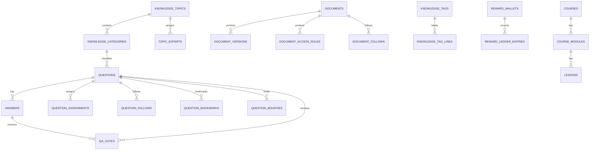

# Learning Service — `learning_db` MySQL

## Trách nhiệm

Learning Service sở hữu Base Square: taxonomy tri thức, Q&A, answers/best answers, document library/version/access, courses/lessons/progress và reward ledger cho hoạt động tri thức. Nó không sở hữu user account, password, social post hoặc Knowledge Graph; mọi user/org-unit reference là UUID từ Identity.

UI mới xác nhận các capability cần schema: topic/category, SME expert, question status/follow/assignment/bookmark/vote/bounty, answer/best answer, document version/follower/confidentiality/review, leaderboard points/coins, và chuyển Best Answer thành tài liệu.

## Sơ đồ dữ liệu

## Taxonomy and Subject Matter Experts

### `knowledge_topics`

| Column | Type | Null | Default | Constraints / description |
| --- | --- | --- | --- | --- |
| `id` | `CHAR(36)` | No | — | PK. |
| `organization_id` | `CHAR(36)` | No | — | Scope. |
| `code` | `VARCHAR(80)` | No | — | Stable normalized code. |
| `name` | `VARCHAR(255)` | No | — | E.g. Marketing, Kỹ thuật, Nhân sự. |
| `description` | `TEXT` | Yes | — | Scope/help for asker. |
| `status` | `VARCHAR(32)` | No | `active` | `active`, `archived`. |
| `sort_order` | `INT UNSIGNED` | No | `0` | Ask-question screen order. |
| timestamps / `deleted_at` | standard | — | — | Archive preferred. |

Indexes: `UNIQUE(organization_id, code)`, `INDEX(organization_id, status, sort_order)`.

### `knowledge_categories`

| Column | Type | Null | Default | Constraints / description |
| --- | --- | --- | --- | --- |
| `id` | `CHAR(36)` | No | — | PK. |
| `organization_id` | `CHAR(36)` | No | — | Scope. |
| `topic_id` | `CHAR(36)` | No | — | FK knowledge_topics. |
| `parent_id` | `CHAR(36)` | Yes | — | Optional self-FK for nested category. |
| `code` / `name` | `VARCHAR(80)` / `VARCHAR(255)` | No | — | Stable code and display name. |
| `description` | `TEXT` | Yes | — | — |
| `status` / `sort_order` | `VARCHAR(32)` / `INT UNSIGNED` | No | `active` / `0` | — |
| timestamps / `deleted_at` | standard | — | — | — |

Indexes: `UNIQUE(topic_id, code)`, `INDEX(organization_id, topic_id, status, sort_order)`.

### `topic_experts`

This is an explicitly assigned SME/curator relationship, separate from AI-derived expertise score.

| Column | Type | Null | Default | Constraints / description |
| --- | --- | --- | --- | --- |
| `id` | `CHAR(36)` | No | — | PK. |
| `organization_id` | `CHAR(36)` | No | — | Scope. |
| `topic_id` / `category_id` | `CHAR(36)` / `CHAR(36)` | No/Yes | — | FK topic; optional FK category for narrow expertise. |
| `user_id` | `CHAR(36)` | No | — | Identity UUID. |
| `expert_role` | `VARCHAR(32)` | No | `sme` | `sme`, `reviewer`, `curator`, `mentor`. |
| `is_primary` | `BOOLEAN` | No | `false` | UI’s responsible expert. |
| `assignment_status` | `VARCHAR(32)` | No | `active` | `active`, `inactive`. |
| `assigned_by_user_id` | `CHAR(36)` | Yes | — | Admin actor. |
| `starts_at` / `ends_at` | `DATETIME(6)` / `DATETIME(6)` | No/Yes | — | Effective dates. |
| timestamps | standard | No | — | — |

Indexes: `UNIQUE(topic_id, category_id, user_id, expert_role)`, `INDEX(user_id, assignment_status)`, `INDEX(topic_id, assignment_status, is_primary)`.

## Q&A

### `questions`

| Column | Type | Null | Default | Constraints / description |
| --- | --- | --- | --- | --- |
| `id` | `CHAR(36)` | No | — | PK. |
| `organization_id` | `CHAR(36)` | No | — | Scope. |
| `topic_id` / `category_id` | `CHAR(36)` / `CHAR(36)` | No | — | FKs; category must belong to topic. |
| `author_user_id` | `CHAR(36)` | No | — | Identity UUID. |
| `title` | `VARCHAR(500)` | No | — | Required question title. |
| `body_markdown` / `body_plaintext` | `MEDIUMTEXT` / `MEDIUMTEXT` | No/No | — | Rich text source and sanitised search excerpt. |
| `question_status` | `VARCHAR(32)` | No | `open` | `draft`, `open`, `answered`, `resolved`, `closed`, `hidden`, `removed`. |
| `accepted_answer_id` | `CHAR(36)` | Yes | — | Same-service answer reference; app validates answer belongs to this question. |
| `accepted_at` | `DATETIME(6)` | Yes | — | Set with accepted answer. |
| `visibility` | `VARCHAR(32)` | No | `organization` | `organization`, `org_unit`, `restricted`; exact ACL links pending decision. |
| `moderation_status` | `VARCHAR(32)` | No | `clear` | `clear`, `flagged`, `under_review`, `hidden`, `blocked`. |
| `answer_count` / `view_count` / `vote_score` | `INT UNSIGNED` / `BIGINT UNSIGNED` / `INT` | No | `0` | Rebuildable cached counters. |
| `last_activity_at` | `DATETIME(6)` | No | — | Latest answer/comment/activity sort. |
| `edited_at` / `closed_at` | `DATETIME(6)` / `DATETIME(6)` | Yes | — | Lifecycle audit. |
| timestamps / `deleted_at` | standard | — | — | — |

Indexes: `INDEX(organization_id, question_status, created_at DESC, id)`, `INDEX(category_id, question_status, last_activity_at DESC)`, `INDEX(author_user_id, created_at DESC)`, `INDEX(accepted_answer_id)`, full-text `title, body_plaintext` only after Vietnamese search design.

### `answers`

| Column | Type | Null | Default | Constraints / description |
| --- | --- | --- | --- | --- |
| `id` | `CHAR(36)` | No | — | PK. |
| `organization_id` | `CHAR(36)` | No | — | Scope. |
| `question_id` | `CHAR(36)` | No | — | FK questions. |
| `author_user_id` | `CHAR(36)` | No | — | Identity UUID. |
| `body_markdown` / `body_plaintext` | `MEDIUMTEXT` / `MEDIUMTEXT` | No/No | — | Sanitized server-side. |
| `answer_status` | `VARCHAR(32)` | No | `published` | `draft`, `published`, `hidden`, `removed`. |
| `is_best_answer` | `BOOLEAN` | No | `false` | Application transaction keeps max one accepted/best answer per question. |
| `best_answer_at` | `DATETIME(6)` | Yes | — | Award/review timing. |
| `vote_score` | `INT` | No | `0` | Projection, source is votes. |
| `moderation_status` | `VARCHAR(32)` | No | `clear` | — |
| `edited_at` | `DATETIME(6)` | Yes | — | — |
| timestamps / `deleted_at` | standard | — | — | — |

Indexes: `INDEX(question_id, answer_status, created_at ASC)`, `INDEX(author_user_id, created_at DESC)`, `INDEX(question_id, is_best_answer)`.

### Question interaction tables

| Table | Essential columns | Invariant / use |
| --- | --- | --- |
| `qa_votes` | `id`, `organization_id`, `target_type`, `target_id`, `voter_user_id`, `vote_value`, `created_at`, `updated_at` | `target_type`=`question`/`answer`; `vote_value` `1` or `-1` only if downvote approved. `UNIQUE(target_type, target_id, voter_user_id)`. |
| `question_follows` | `question_id`, `user_id`, `created_at` | Receives updates; PK `(question_id, user_id)`. |
| `question_bookmarks` | `question_id`, `user_id`, `created_at` | “Đánh dấu của tôi”; private; PK `(question_id, user_id)`. |
| `question_assignments` | `id`, `question_id`, `assignee_user_id`, `assigned_by_user_id`, `assignment_type`, `status`, `assigned_at`, `responded_at` | Supports “Giao cho tôi” and Expert Finder invitation. `assignment_type`=`manual`,`topic_expert`,`ai_suggested`; AI suggestions require consent/approval. |
| `qa_comments` | `id`, `organization_id`, `target_type`, `target_id`, `author_user_id`, `body_markdown`, `body_plaintext`, `status`, timestamps, `deleted_at` | Use only if product confirms comments are distinct from answers; UI currently ambiguous. |

### `question_bounties`

UI shows points/coins and “0 phần thưởng”; chat mock mentions `bounties`. Use an explicit hold/award record, never decrement wallet ad hoc.

| Column | Type | Null | Default | Constraints / description |
| --- | --- | --- | --- | --- |
| `id` | `CHAR(36)` | No | — | PK. |
| `organization_id` / `question_id` | `CHAR(36)` | No/No | — | Scope/FK. |
| `sponsor_user_id` | `CHAR(36)` | No | — | User whose coins are reserved. |
| `currency_type` | `VARCHAR(16)` | No | `coin` | `coin` or approved reward unit; no money. |
| `amount` | `BIGINT UNSIGNED` | No | — | Positive integer. |
| `status` | `VARCHAR(32)` | No | `held` | `held`, `awarded`, `refunded`, `cancelled`, `expired`. |
| `winner_answer_id` | `CHAR(36)` | Yes | — | FK answers when awarded. |
| `hold_ledger_entry_id` / `settlement_ledger_entry_id` | `CHAR(36)` | No/Yes | — | Links immutable reward ledger. |
| `expires_at` / `awarded_at` | `DATETIME(6)` | Yes | — | Policy controlled. |
| timestamps | standard | No | — | — |

Indexes: `INDEX(question_id, status)`, `INDEX(sponsor_user_id, status, created_at DESC)`.

## Tags and related knowledge

### `knowledge_tags` and `knowledge_tag_links`

| Table | Essential columns | Rules |
| --- | --- | --- |
| `knowledge_tags` | `id`, `organization_id`, `normalized_name`, `display_name`, `description`, `status`, `created_by_user_id`, timestamps | `UNIQUE(organization_id, normalized_name)`. Canonical application tag, not Neo4j node itself. |
| `knowledge_tag_links` | `organization_id`, `tag_id`, `target_type`, `target_id`, `assigned_source`, `assigned_by_user_id`, `confidence_score`, `created_at` | `target_type`=`question`,`answer`,`document`,`course`,`lesson`; `UNIQUE(tag_id,target_type,target_id)`. AI assignment starts as proposal until approved. |

`related_content_links` may be added only after deciding whether related questions are manual, AI-generated or both. Do not write automated related content directly as truth without provenance.

## Document library and confidentiality

### `documents`

`documents` is the stable logical work. A file replacement creates a `document_versions` row, not an overwrite.

| Column | Type | Null | Default | Constraints / description |
| --- | --- | --- | --- | --- |
| `id` | `CHAR(36)` | No | — | PK. |
| `organization_id` | `CHAR(36)` | No | — | Scope. |
| `document_code` | `VARCHAR(128)` | Yes | — | Human code, e.g. `DOC-HR-2026-08`; unique when present. |
| `topic_id` / `category_id` | `CHAR(36)` / `CHAR(36)` | No/Yes | — | Taxonomy FK. |
| `owner_user_id` | `CHAR(36)` | No | — | Author/uploader UUID. |
| `title` | `VARCHAR(500)` | No | — | Required UI title. |
| `description_markdown` / `description_plaintext` | `TEXT` / `TEXT` | Yes/Yes | — | Optional. |
| `document_kind` | `VARCHAR(32)` | No | `document` | `ebook`, `policy`, `procedure`, `training`, `template`, `article`. |
| `confidentiality_level` | `VARCHAR(32)` | No | `internal` | `organization`, `internal`, `restricted`, `confidential`; maps UI wording. |
| `publication_status` | `VARCHAR(32)` | No | `draft` | `draft`, `pending_review`, `published`, `rejected`, `archived`, `removed`. |
| `current_version_id` | `CHAR(36)` | Yes | — | Application-validated version; no FK cycle required. |
| `source_type` / `source_id` | `VARCHAR(32)` / `CHAR(36)` | Yes/Yes | — | `upload`, `qa_best_answer`, `migration`; provenance. |
| `published_at` / `archived_at` | `DATETIME(6)` / `DATETIME(6)` | Yes/Yes | — | — |
| `view_count` / `download_count` | `BIGINT UNSIGNED` / `BIGINT UNSIGNED` | No | `0` | Rebuildable stats. |
| timestamps / `deleted_at` | standard | — | — | — |

Indexes: `UNIQUE(organization_id, document_code)`, `INDEX(organization_id, publication_status, published_at DESC)`, `INDEX(category_id, publication_status, published_at DESC)`, `INDEX(owner_user_id, created_at DESC)`, `INDEX(confidentiality_level, publication_status)`.

### `document_versions` and `document_files`

| Table | Essential columns | Rules |
| --- | --- | --- |
| `document_versions` | `id`, `document_id`, `version_number`, `version_label`, `change_summary`, `created_by_user_id`, `approval_status`, `approved_by_user_id`, `approved_at`, `supersedes_version_id`, timestamps | `UNIQUE(document_id, version_number)`; a published document must point to an approved clean version. |
| `document_files` | `id`, `document_version_id`, `object_key`, `original_filename`, `mime_type`, `size_bytes`, `sha256`, `page_count`, `scan_status`, `extraction_status`, `preview_status`, `uploaded_at`, timestamps | Verified MIME accepts proposed PDF/DOCX/XLSX; default file max must be policy-driven (Admin mock says 50MB). `UNIQUE(document_version_id, sha256)` optional. |

### Access, review and engagement

| Table | Essential columns | Rules |
| --- | --- | --- |
| `document_access_rules` | `id`, `document_id`, `principal_type`, `principal_id`, `access_level`, `granted_by_user_id`, `starts_at`, `ends_at`, timestamps | `principal_type`=`organization`,`org_unit`,`role`,`user`; `principal_id` UUID/reference where relevant. Application evaluates Identity membership/role; never trust a copied label. |
| `document_reviews` | `id`, `document_version_id`, `reviewer_user_id`, `review_action`, `note`, `reviewed_at` | `review_action`=`approve`,`reject`,`request_changes`,`revoke`; append-only. |
| `document_follows` | `document_id`, `user_id`, `created_at` | UI “Người theo dõi”; PK `(document_id,user_id)`. |
| `document_votes` | `document_id`, `user_id`, `vote_value`, `created_at`, `updated_at` | PK `(document_id,user_id)`; decide whether score impacts reward. |
| `document_access_events` | `id`, `document_id`, `document_version_id`, `user_id`, `event_type`, `occurred_at`, `correlation_id`, `ip_hash` | `event_type`=`view`,`download`,`preview`; retention policy required. Aggregate to document stats; audit restricted accesses. |

## Courses and learning progress

Courses/lessons appear in base architecture and Welcome mock although detailed current screens center on documents/Q&A. Preserve these tables but defer implementation until a course workflow is approved.

| Table | Essential columns | Rules |
| --- | --- | --- |
| `courses` | `id`, `organization_id`, `topic_id`, `owner_user_id`, `title`, `description_markdown`, `status`, `visibility`, `published_at`, timestamps, `deleted_at` | `status`=`draft`,`published`,`archived`. |
| `course_modules` | `id`, `course_id`, `title`, `description`, `sort_order`, timestamps | `UNIQUE(course_id, sort_order)`. |
| `lessons` | `id`, `course_module_id`, `lesson_type`, `title`, `content_markdown`, `document_id`, `video_object_key`, `duration_seconds`, `sort_order`, `status`, timestamps | Only one source reference per lesson type; document ID is same-service FK. |
| `course_enrollments` | `id`, `course_id`, `user_id`, `enrollment_status`, `enrolled_at`, `completed_at`, `assigned_by_user_id`, timestamps | `UNIQUE(course_id,user_id)`. |
| `lesson_progress` | `id`, `lesson_id`, `user_id`, `progress_percent`, `last_position_seconds`, `started_at`, `completed_at`, timestamps | `UNIQUE(lesson_id,user_id)`; use integer percent 0–100. |

## Reward and leaderboard

### Ownership proposal

The Learning Service should own the immutable **points/coins ledger displayed by Base Square Leaderboard**. Social can emit approved events such as an upvote; Learning applies a versioned reward rule to create ledger entry. This avoids two services independently mutating a “reputation” balance. AI expertise is a projection, not wallet truth. This requires owner approval (OQ-029/OQ-033).

### `reward_wallets`, `reward_ledger_entries`, `reward_rules`, `leaderboard_snapshots`

| Table | Essential columns | Rules |
| --- | --- | --- |
| `reward_wallets` | `id`, `organization_id`, `user_id`, `points_balance`, `coins_balance`, `last_ledger_sequence`, `updated_at` | `UNIQUE(organization_id,user_id)`; convenience projection only. Balances updated transactionally with ledger. |
| `reward_ledger_entries` | `id`, `organization_id`, `user_id`, `currency_type`, `amount_delta`, `balance_after`, `entry_type`, `reason_code`, `source_service`, `source_event_id`, `source_type`, `source_id`, `rule_code`, `occurred_at`, `created_at`, `reversal_of_entry_id`, `metadata_json` | Immutable. `currency_type`=`point`,`coin`; no float. `UNIQUE(source_service,source_event_id,rule_code,currency_type)` for idempotency. |
| `reward_rules` | `id`, `organization_id`, `code`, `trigger_event_type`, `points_delta`, `coins_delta`, `eligibility_json`, `daily_limit`, `effective_from`, `effective_to`, `status`, `approved_by_user_id`, timestamps | UI asks 11 points/question and 10/answer; configure approved values here, never hardcode UI numbers. |
| `leaderboard_snapshots` | `id`, `organization_id`, `period_type`, `period_start`, `period_end`, `dimension_type`, `dimension_id`, `rank`, `user_id`, `points_total`, `coins_total`, `generated_at` | Optional read projection/export performance. Unique `(organization_id,period_type,period_start,dimension_type,dimension_id,rank)`. |

## Learning-local moderation and events

| Table | Essential columns | Purpose |
| --- | --- | --- |
| `learning_content_reports` | `id`, `organization_id`, `target_type`, `target_id`, `reporter_user_id`, `source`, `reason_code`, `detail`, `risk_score`, `status`, `opened_at`, `resolved_at`, timestamps | For question/answer/document. Mirrors Social case ownership; Admin queue aggregates. |
| `learning_moderation_actions` | `id`, `report_id`, `target_type`, `target_id`, `action_type`, `actor_type`, `actor_user_id`, `reason_code`, `note`, `previous_state_json`, `new_state_json`, `created_at` | Append-only; applies content state in owning tables. |
| `outbox_events` / `processed_events` | Same contract as Social | Events include document publish/version/revoke, question/answer/accepted answer, reward and access change. |

## Learning invariants

1. A category must belong to the selected topic; a question/document cannot point to a category in another topic.
2. At most one accepted/best answer can be active per question; awarding/reversing reward occurs in the same business transaction/outbox sequence.
3. `question_status=resolved` requires `accepted_answer_id`; closed does not necessarily mean answered.
4. A document version is immutable after approval/publish. Replace it by creating a new version.
5. Document download/preview evaluates confidentiality plus access rules against live Identity role/org-unit state.
6. A source document/answer cannot enter AI indexing until publication/scan/access policy allows it.
7. Ledger entries are immutable; correction is a compensating entry, never an UPDATE/DELETE of historical points.

## Evidence

- `design/exports/html-tailwind/08-learning-home.html`, `08b-learning-detail.html`, `09-qa-list.html`, `10-qa-detail.html`, `11-ask-question.html`, `12-leaderboard.html`
- `design/exports/admin/05-knowledge-qa-admin.html`, `06-document-management.html`
- `Cấu trúc cuối cùng.md`, section 4
