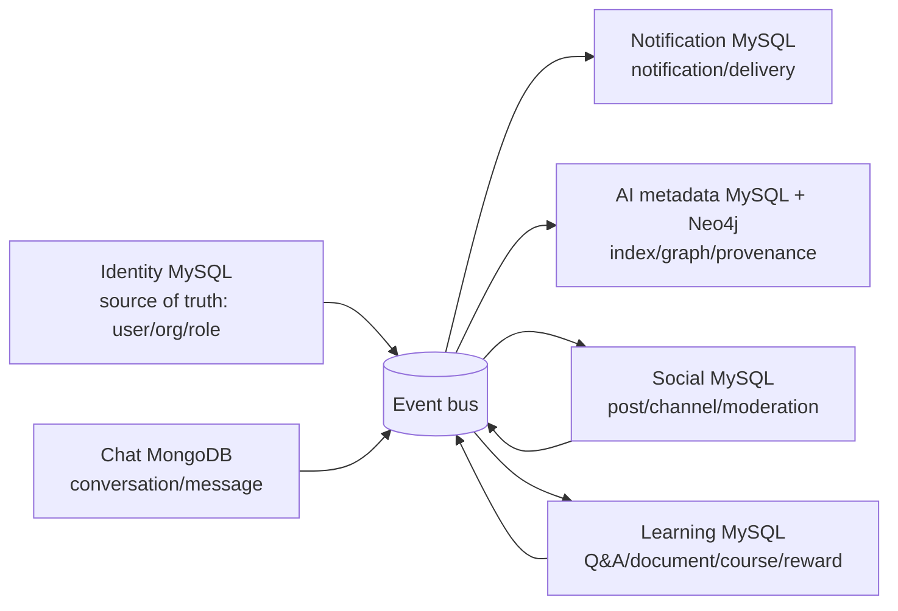

# 07 — Ranh giới dữ liệu và hợp đồng liên service

> **Trạng thái: PROPOSED / cần chốt trước khi viết migration và event consumer.**  
> Tài liệu này ngăn việc các service truy cập thẳng database của nhau. Nó bổ sung cho thiết kế bảng của từng service, không thay thế chúng.

## 1. Nguyên tắc bắt buộc

Mỗi service là chủ sở hữu duy nhất của database của mình. Service khác chỉ được dùng một trong ba cách:

1. gọi API công khai của service chủ quản;
2. tiêu thụ domain event đã công bố; hoặc
3. dùng read model/projection do chính service tiêu thụ sở hữu.

Không được tạo foreign key xuyên database, join xuyên service, hoặc ghi trực tiếp vào bảng của service khác. Ví dụ Social chỉ lưu `author_user_id`; không được copy mật khẩu hay sửa `identity_db.users`.



## 2. Danh mục ownership và reference

| Dữ liệu | Chủ sở hữu | Ai được tham chiếu | Quy tắc |
|---|---|---|---|
| Tổ chức, phòng ban, người dùng, role | Identity | Tất cả service | chỉ lưu UUID, lấy tên/avatar qua projection/API |
| Kênh, bài viết, reaction, report | Social | Notification, AI, Admin read model | Social quyết định visibility/moderation |
| Chủ đề, Q&A, tài liệu, khóa học, điểm/coin | Learning | Notification, AI, Admin read model | Learning quyết định knowledge visibility |
| Hội thoại, thành viên, tin nhắn | Chat | Notification, AI (nếu được phép) | Chat không public nội dung mặc định |
| Notification/push/email | Notification | không service nào ghi thẳng | nhận command/event có idempotency key |
| Vector/chunk/đồ thị tri thức | AI/Knowledge | Search, Admin | chỉ index nội dung đã được phép index |

### 2.1. Reference chỉ là định danh, không phải foreign key

Các cột sau nên dùng tên nhất quán: `organization_id`, `actor_user_id`, `author_user_id`, `target_user_id`, `source_id`, `source_type`. Chúng là UUID có format kiểm tra ở application layer; database của service sở hữu không xác minh bằng FK sang database khác.

Nếu cần hiển thị nhanh tên/ảnh người dùng, consumer lưu projection tối thiểu, ví dụ `user_directory_projection(user_id, organization_id, display_name, avatar_url, employment_status, updated_at)`. Projection là cache có thể rebuild từ event `identity.user.updated`; không được trở thành nguồn dữ liệu chính.

## 3. Outbox và inbox: contract vật lý chuẩn

Các service MySQL dùng cùng logical schema sau; Chat dùng collection tương đương đã mô tả tại `04-chat-service-mongodb.md`.

### `outbox_events`

| Cột | Kiểu đề xuất | Ý nghĩa |
|---|---|---|
| `id` | `CHAR(36)` PK | UUID event bất biến |
| `organization_id` | `CHAR(36)` NULL | tenant; NULL chỉ với system event có lý do rõ |
| `event_type` | `VARCHAR(120)` | ví dụ `learning.answer.accepted.v1` |
| `aggregate_type` | `VARCHAR(64)` | `question`, `post`, `user`... |
| `aggregate_id` | `CHAR(36)` | aggregate phát sinh event |
| `payload_json` | `JSON` | contract versioned, không chứa secret |
| `occurred_at` | `DATETIME(6)` | lúc domain action thành công |
| `trace_id` | `VARCHAR(128)` NULL | truy vết request xuyên service |
| `published_at` | `DATETIME(6)` NULL | relay cập nhật sau khi broker xác nhận |
| `publish_attempts` | `INT UNSIGNED` | theo dõi retry |
| `last_error_code` | `VARCHAR(80)` NULL | mã lỗi rút gọn, không ghi PII/secret |

Index bắt buộc: `(published_at, occurred_at)` cho relay; `(aggregate_type, aggregate_id, occurred_at)` cho điều tra; `(organization_id, occurred_at)` cho tenant audit. Domain write và insert outbox nằm **cùng transaction**.

### `processed_events`

| Cột | Kiểu đề xuất | Ý nghĩa |
|---|---|---|
| `consumer_name` | `VARCHAR(100)` | tên consumer ổn định, ví dụ `notification.social-post-created` |
| `event_id` | `CHAR(36)` | event đã xử lý |
| `event_type` | `VARCHAR(120)` | hỗ trợ audit/debug |
| `processed_at` | `DATETIME(6)` | thời điểm commit side effect |
| `result_hash` | `CHAR(64)` NULL | dấu vết payload/version khi cần |

Khóa chính kép `(consumer_name, event_id)` làm xử lý at-least-once trở thành idempotent. Consumer phải ghi inbox marker và side effect trong một transaction cục bộ (hoặc dùng unique business key tương đương) trước khi ACK broker.

## 4. Envelope event chung

Tất cả event domain phải có envelope versioned. Đây là JSON minh họa, không phải một bảng mới.

```json
{
  "eventId": "018f...",
  "eventType": "social.post.published.v1",
  "occurredAt": "2026-09-11T04:15:22.123456Z",
  "organizationId": "018e...",
  "aggregate": { "type": "post", "id": "018f...", "version": 3 },
  "actorUserId": "018d...",
  "traceId": "req_...",
  "data": {
    "postId": "018f...",
    "channelId": "018f...",
    "authorUserId": "018d...",
    "visibility": "organization"
  }
}
```

Yêu cầu: `eventId`, `eventType`, `occurredAt`, `aggregate` và `data` là bắt buộc; thời gian ISO-8601 UTC; trường mới được phép bổ sung nhưng không đổi nghĩa trường cũ; thay đổi không tương thích phải tăng hậu tố `.v2`. Không phát toàn bộ HTML, file binary, password hash, refresh token, prompt có dữ liệu nhạy cảm, hay nội dung chat riêng tư trong event.

## 5. Event tối thiểu cần công bố

| Producer | Event | Consumer tiềm năng | Dữ liệu tối thiểu |
|---|---|---|---|
| Identity | `identity.user.created.v1`, `updated.v1`, `deactivated.v1` | Social, Learning, Chat, Notification, AI | user/org, display projection, active state |
| Identity | `identity.org-unit.changed.v1`, `role-assignment.changed.v1` | Admin projection, authorization cache | object ID/version, không phát permission secret |
| Social | `social.post.published.v1`, `updated.v1`, `removed.v1` | Notification, AI, Admin | post/channel/author/visibility, content snapshot ref |
| Social | `social.post.reported.v1`, `moderated.v1` | Admin, Notification | report/action/status/risk level |
| Learning | `learning.question.created.v1`, `answered.v1`, `answer.accepted.v1` | Notification, AI, Reward | question/answer/author/topic/visibility |
| Learning | `learning.document.published.v1`, `version.published.v1`, `withdrawn.v1` | AI, Notification, Search | doc/version/access class/index eligibility |
| Learning | `learning.reward.earned.v1` | Leaderboard projection, Notification | ledger entry/reference/rule/points/coins |
| Chat | `chat.message.persisted.v1` | Notification | conversation/message/sender/recipient IDs; excerpt only if policy allows |
| AI/Knowledge | `knowledge.ingestion.completed.v1`, `risk.assessed.v1` | Admin, source owner | source/run/status/risk summary; not raw embedding |

`*.removed`/`*.withdrawn` events phải đủ để consumer xóa, ẩn hoặc tombstone projection/index tương ứng. Điều này quan trọng hơn event create vì tránh AI/Search trả về tài liệu đã bị gỡ.

## 6. Quy tắc query xuyên service

| Nhu cầu UI | Cách được phép | Không được làm |
|---|---|---|
| Feed hiển thị tác giả | Social read model hoặc gọi Identity directory batch API | JOIN sang `identity_db.users` |
| Trang profile hiển thị bài/Q&A/tài liệu | BFF/API composition theo cursor hoặc các service tự query domain của họ | một SQL query union trên ba DB |
| Admin dashboard | read model/reporting pipeline được thiết kế riêng | dùng database production của mọi service như data warehouse |
| AI hybrid search | AI metadata + vector/Neo4j, sau đó policy check với source owner | index mọi content rồi lọc ở giao diện |
| Notification khi có comment/answer | event → Notification | Social/Learning insert thẳng `notifications` |

Trong giai đoạn MVP, BFF có thể compose 2–3 API đồng bộ khi dữ liệu ít và yêu cầu realtime thấp. Khi dashboard/search cần đa miền và khối lượng lớn, dùng materialized read model có source/version/timestamp để rebuild được.

## 7. Đồng bộ lifecycle người dùng

Khi người dùng bị khóa/nghỉ việc (`identity.user.deactivated.v1`):

1. Identity chặn session/token mới và xuất event.
2. Social/Learning/Chat/Notification ẩn người dùng khỏi picker, không cho phát sinh hành động mới.
3. Nội dung lịch sử không tự xóa, trừ yêu cầu pháp lý; UI hiển thị định danh đã chuẩn hóa theo chính sách HR.
4. AI/Knowledge cập nhật graph/search permission và loại user khỏi expert recommendation nếu còn active status là điều kiện.
5. Mọi consumer lưu thời điểm xử lý để truy vết độ trễ propagation.

## 8. Contract cần chốt

- Có `organization_id` ngay từ MVP hay chỉ một tổ chức? Khuyến nghị: giữ cột từ đầu, nhưng áp dụng single-tenant logic cho đến khi cần multi-tenant.
- Reward ledger thuộc Learning (khuyến nghị) hay Identity/Reward service độc lập? Không cho Social và Learning cùng tự sửa một balance.
- Nội dung chat nào, nếu có, được đưa vào AI index? Khuyến nghị mặc định là **không**.
- Admin có cần một analytics warehouse riêng hay chỉ read model vận hành? Không dùng bảng transaction làm warehouse.

Xem thêm [00 — Tổng quan](00-database-overview.md), [03 — Learning](03-learning-service-mysql.md), [05 — Notification](05-notification-service-mysql.md), và [06 — AI/Knowledge](06-ai-knowledge-mysql-neo4j.md).
