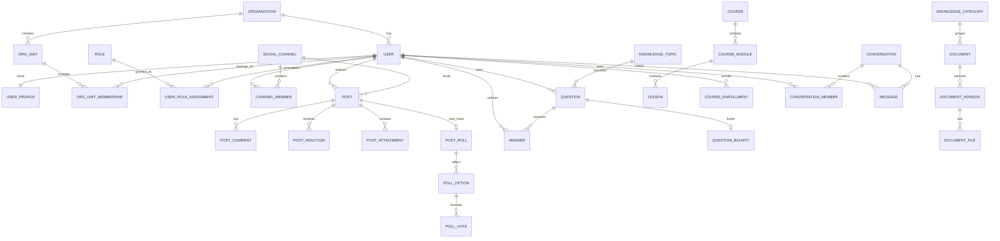

# 08 — ERD logic, index và nguyên tắc hiệu năng

> **Trạng thái: PROPOSED.** Đây là sơ đồ logic để review quan hệ và index trước khi sinh migration. Nó không ép các database khác loại vào một ERD vật lý duy nhất.

## 1. Bản đồ quan hệ cấp domain

Các `USER` xuất hiện ở Social/Learning/Chat là **logical external reference** đến Identity, không phải foreign key vật lý xuyên database. `DOCUMENT`, `QUESTION`, `ANSWER`, `POST` có thể được AI index qua event nhưng database AI không là chủ sở hữu nội dung gốc.

## 2. Quy ước index chung

Mọi bảng transactional lớn nên có:

- PK UUID `id`.
- Index `(organization_id, created_at DESC, id DESC)` nếu có trang danh sách theo tenant và cursor pagination.
- Index theo foreign key cục bộ (ví dụ `post_id`, `question_id`, `document_id`) đúng với chiều query thực tế.
- Cột trạng thái/visibility chỉ đứng đầu composite index khi tính chọn lọc đủ cao và trùng query. Không tạo index đơn lẻ trên boolean như `is_deleted`.
- Unique constraint thực hiện invariant nghiệp vụ; index không chỉ để tối ưu. Ví dụ `(post_id, user_id, reaction_type)` hay `(question_id, user_id)`.
- Không đánh index mù mọi cột text hoặc JSON. Những điều kiện JSON thường xuyên phải được chuẩn hóa thành cột hoặc generated column được review.

MySQL InnoDB với UUID cần thống nhất `CHAR(36) CHARACTER SET ascii COLLATE ascii_bin` ở MVP cho tính dễ đọc. Nếu khối lượng lớn, chuyển có kế hoạch sang `BINARY(16)` có helper encode/decode; không trộn hai format tùy bảng.

## 3. Index theo query UI quan trọng

| Bề mặt UI | Query/path chính | Index đề xuất | Ghi chú |
|---|---|---|---|
| Social feed | bài theo channel/visibility, mới nhất | `posts(channel_id, status, published_at DESC, id DESC)` | cursor dựa `published_at,id` |
| Social news | bài theo category, pinned trước | `social_post_categories(category_id, post_id)` + `posts(status,published_at)` | pin ưu tiên qua query riêng hoặc rank projection |
| Profile activity | bài của tác giả | `posts(author_user_id, status, published_at DESC, id DESC)` | không offset khi dữ liệu tăng |
| Post detail | comment theo bài/cây | `post_comments(post_id, parent_comment_id, created_at, id)` | trả top-level rồi batch children |
| Q&A list | topic/status/newest | `questions(topic_id, status, created_at DESC, id DESC)` | thêm `last_activity_at` nếu sort active |
| Q&A detail | answer accepted + score | `answers(question_id, status, is_accepted DESC, vote_score DESC, created_at)` | score là denormalized có kiểm soát |
| Document library | category/access/publish time | `documents(category_id,status,visibility,published_at DESC,id DESC)` | access rule phức tạp có thể cần projection |
| Document versions | versions của 1 tài liệu | `UNIQUE(document_id, version_number)` | chỉ một current version enforce app/trigger carefully |
| Learning progress | user theo course | `UNIQUE(user_id,course_id)` | module/lesson joins cục bộ |
| Leaderboard | scope/period/rank | `UNIQUE(organization_id,scope_type,scope_id,period_type,period_start,user_id)` + rank index | snapshot, không sum ledger mỗi request |
| Notifications | inbox chưa đọc | `notifications(recipient_user_id, read_at, created_at DESC,id DESC)` | có thể thêm archive status |
| Chat inbox | conversations của user | Mongo `conversation_members {userId,lastActivityAt}` | separate member collection/read model |
| Chat history | messages theo conversation | Mongo `{conversationId:1,createdAt:-1,_id:-1}` | seek cursor |
| AI ingest | chunk theo source/version | `ai_content_chunks(source_type,source_id,source_version,chunk_index)` unique | dùng source snapshot hash để dedupe |

## 4. Full-text, semantic search và filter

Full-text search không nên dựa trên `LIKE '%keyword%'`. Chọn một trong các phương án sau sau benchmark tiếng Việt:

1. MySQL FULLTEXT cho phạm vi MVP hẹp và nội dung đã chuẩn hóa;
2. search engine chuyên dụng khi cần typo tolerance, ranking, Vietnamese analyzer và facet; hoặc
3. hybrid: lexical engine + vector store + graph expansion như UI Hybrid Search mô tả.

Search index phải mang ít nhất: `organization_id`, `source_type`, `source_id`, `source_version`, `visibility`, `access_scope`, `deleted/withdrawn status`, `indexed_at`. Authorization filter phải được áp dụng **trước hoặc ngay trong truy vấn index**, không chỉ ẩn kết quả ở frontend.

Vector index không nằm trong MySQL transaction. Khi source được publish, outbox phát event; ingestion worker chunk/embed/upsert; lưu `embedding_index_references` và trạng thái. Khi source rút/gỡ, phát event tombstone và xác minh xóa vector/graph/index.

## 5. Denormalization được phép

Các bảng/cột tóm tắt được chấp nhận vì UI cần đếm/sort nhanh, nhưng không là nguồn gốc:

| Projection/cột | Source of truth | Cách cập nhật |
|---|---|---|
| `post_stats` | reactions/comments/views | transaction/event idempotent; có job reconcile |
| `answers.vote_score`, `questions.answer_count` | `qa_votes`, `answers` | transaction hoặc consumer idempotent |
| `documents.download_count`, `follower_count` | access/follow events | async allowed; hiển thị eventual consistency |
| `reward_wallets` | `reward_ledger_entries` | cùng transaction với ledger; định kỳ reconcile |
| `leaderboard_snapshots` | reward ledger | batch/scheduled snapshot, có `computed_at` |
| user directory projection | Identity | consumer từ versioned identity events |
| search/Neo4j index | source content | asynchronous ingestion; có version/status |

Không được denormalize password, refresh token, full document binary, hay quyền nhạy cảm sang read model không cần thiết.

## 6. Phân vùng, archive và dung lượng

Chưa có số liệu traffic nên không partition ngay. Thiết kế các bảng append-heavy để partition sau được: `audit_events`, `outbox_events`, `notifications`, `notification_deliveries`, `document_access_events`, `reward_ledger_entries`, `message_delivery_attempts`, và có thể `messages` MongoDB.

Điều kiện trước khi partition: số liệu row growth, retention được duyệt, query plan, cách xóa/archive test trên restore copy. Khuyến nghị partition theo tháng/quý trên `occurred_at`/`created_at` nếu retention buộc phải xóa theo thời gian. Không partition `users`, `roles`, `questions` chỉ vì dự đoán.

## 7. Tránh N+1 và offset sâu

- API list trả `next_cursor`, không dùng `OFFSET` lớn; cursor gồm sort timestamp + UUID.
- Feed lấy post, sau đó batch author/channel/stat/attachment bằng `IN` có giới hạn hoặc read model.
- Q&A lấy answers trang đầu, không trả toàn bộ comments/votes trong payload.
- Chat history dùng cursor message; không nhúng mảng messages vô hạn trong một conversation Mongo document.
- Dashboard dùng aggregate/snapshot được định nghĩa, không chạy nhiều `COUNT(*)` lớn trực tiếp lúc render.

## 8. Kế hoạch kiểm chứng trước migration

1. Chọn 8–12 query quan trọng từ bảng trên và viết `EXPLAIN ANALYZE` với dữ liệu seed gần thực tế.
2. Kiểm tra index unique cho race condition: reaction, vote Q&A, follow, bookmark, enrollment, read marker.
3. Load test feed, Q&A list/detail, document search, chat history và notification inbox theo SLO được chốt.
4. Chạy job reconcile cho counter/wallet trên bản sao dữ liệu; kết quả phải idempotent.
5. Kiểm tra truy vấn của tenant A không bao giờ trả row tenant B, cả ở index/search/graph.

Xem [07 — Hợp đồng liên service](07-cross-service-data-contracts.md) để biết cột nào chỉ là reference và [09 — Lifecycle/bảo mật/vận hành](09-data-lifecycle-security-operations.md) cho retention, backup, restore.
