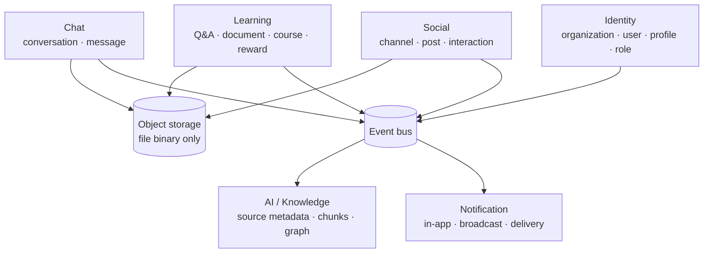

# Database design — Social & Learning Platform

> **Mục đích:** bộ phân tích database có thể review trước khi tạo migration.  
> **Trạng thái hiện tại repository:** chưa có source/migration/database schema chạy thật để đối chiếu. Toàn bộ thiết kế trong thư mục này là **PROPOSED**, dựa trên tài liệu đề tài, phân tích hiện có trong `docs/specs/` và giao diện mới ở `design/exports/html-tailwind` cùng `design/exports/admin`.
>
> **Baseline triển khai đang có hiệu lực:** [IMPLEMENTATION_BASELINE.md](../Base_du_an/IMPLEMENTATION_BASELINE.md). Khi phần thiết kế đề xuất trong thư mục này khác với baseline đã chốt, implementation phải theo baseline.

## Đọc theo thứ tự

1. [00 — Tổng quan và nguyên tắc](00-database-overview.md)
2. [01 — Identity Service / MySQL](01-identity-service-mysql.md)
3. [02 — Social Service / MySQL](02-social-service-mysql.md)
4. [03 — Learning Service / MySQL](03-learning-service-mysql.md)
5. [04 — Chat Service / MongoDB](04-chat-service-mongodb.md)
6. [05 — Notification Service / MySQL](05-notification-service-mysql.md)
7. [06 — AI & Knowledge / MySQL + Neo4j](06-ai-knowledge-mysql-neo4j.md)
8. [07 — Hợp đồng dữ liệu liên service](07-cross-service-data-contracts.md)
9. [08 — ERD logic và index plan](08-logical-erd-and-index-plan.md)
10. [09 — Lifecycle, bảo mật và vận hành](09-data-lifecycle-security-operations.md)
11. [10 — Quyết định cần chốt](10-open-decisions.md)
12. [11 — Ma trận UI/chức năng → dữ liệu](11-ui-to-data-coverage.md)

## Bản đồ dữ liệu

Mỗi service sở hữu database riêng; UUID sang service khác chỉ là reference, không dùng foreign key/join xuyên database. Object storage giữ binary; database chỉ giữ metadata và object key. Redis/cache, broker và search/vector index không là source of truth.

## Điều cần bạn review trước tiên

Đọc [10 — Quyết định cần chốt](10-open-decisions.md), đặc biệt: mô hình tổ chức/tenant, đăng nhập & role scope, document access, ownership points/coin, chat retention/quyền xem, và phạm vi AI được phép index. Những quyết định này thay đổi schema nhiều hơn các tên cột nhỏ.

## Quy ước trong tài liệu

- `CHAR(36)` UUID là đề xuất MVP (ASCII/binary collation); có thể tối ưu `BINARY(16)` sau benchmark.
- `DATETIME(6)` dùng UTC. Danh sách dùng cursor thay vì offset sâu.
- `organization_id` là bắt buộc trên dữ liệu business trừ global catalog có chủ đích.
- `status`, `visibility`, `deleted_at` và audit/event có nghĩa theo từng service; không tự suy ra quyền từ UI.
- Bảng `outbox_events`/`processed_events` là contract idempotency, không là chức năng UI.

## Không nằm trong phạm vi hiện tại

Tài liệu chưa tạo migration, dữ liệu seed, DDL vendor-specific, cấu hình DB/backup thực tế, hay chọn AI/vector/search provider. Các phần đó phải được tạo sau khi các quyết định mở được duyệt.

Các tài liệu dự án cấp cao trước đó vẫn nằm ở [docs/specs](../specs/PROJECT_SPEC.md).
