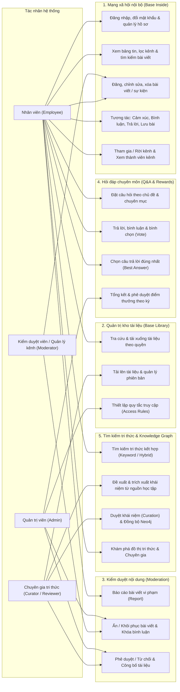

# Khảo sát hệ thống tương tự, Phạm vi, Tiêu chí đánh giá và Mô hình Use Case

Tài liệu này hoàn thiện các đầu ra bắt buộc của **Giai đoạn 1** (*Đề cương, mục tiêu, phạm vi, khảo sát hệ thống tương tự và tiêu chí đánh giá*) và **Giai đoạn 2** (*Biểu đồ Use Case, quy trình nghiệp vụ và danh sách chức năng cho 5 phân hệ: Mạng xã hội, Quản trị tài liệu, Kiểm duyệt, Hỏi đáp và Tìm kiếm tri thức*).

---

## 1. Đề cương, Mục tiêu và Phạm vi hệ thống (Giai đoạn 1)

### 1.1. Đề cương thực hiện đồ án

1. **Chương 1 — Tổng quan đề tài và khảo sát thực tế:** Bối cảnh phân mảnh truyền thông & tri thức nội bộ doanh nghiệp; khảo sát các nền tảng hiện có; xác định mục tiêu, phạm vi và lựa chọn công nghệ.
2. **Chương 2 — Phân tích yêu cầu hệ thống:** Xác định tác nhân (Actors), phân quyền theo phạm vi tổ chức (Scoped RBAC), danh sách yêu cầu chức năng/phi chức năng, mô hình Use Case và quy trình nghiệp vụ cốt lõi.
3. **Chương 3 — Thiết kế kiến trúc, CSDL, Kho tài liệu và Knowledge Graph:** Thiết kế kiến trúc Microservices qua API Gateway, thiết kế ERD đa cơ sở dữ liệu (MySQL, MongoDB), lược đồ đồ thị tri thức Neo4j, hợp đồng OpenAPI và giao diện Web/Mobile.
4. **Chương 4 — Triển khai mạng xã hội nội bộ, kho tài liệu và AI/Knowledge Graph:** Xây dựng các phân hệ Identity/Admin, Social (Base Inside), Learning/Q&A/Library (Base Square), Chat/Notification và AI Knowledge Curation trên Web (Vue 3) và Mobile (Flutter - Dart 3).
5. **Chương 5 — Kiểm thử, đánh giá và kết luận:** Kết quả kiểm thử tự động (Unit/Feature/Integration), nghiệm thu theo kịch bản phân quyền và hướng phát triển.

### 1.2. Khảo sát và đối sánh các hệ thống tương tự

| Tiêu chí đối sánh | Meta Workplace / Viva Engage | Base Inside + Base Square | Atlassian Confluence + Q&A | **Hệ thống đề xuất (Openhello.vn / NexaHub)** |
| :--- | :--- | :--- | :--- | :--- |
| **Mạng xã hội nội bộ (Feed, Kênh, Tương tác)** | Mạnh về truyền thông, nhóm, sự kiện và tương tác thời gian thực | Tốt cho truyền thông nội bộ, thông báo công ty và văn hóa doanh nghiệp | Không có bảng tin mạng xã hội chuyên biệt | **Đáp ứng đầy đủ:** Bảng tin, kênh mở/quản lý, bài viết, thông báo bắt buộc xác nhận, cảm xúc, bình luận, lưu bài trên cả Web và Mobile |
| **Quản trị kho tài liệu & Phiên bản** | Chỉ đính kèm tệp theo bài đăng, khó tra cứu có cấu trúc | Tách rời ở phân hệ khác, hạn chế quản lý phiên bản và kiểm duyệt sâu | Mạnh về quản lý trang tài liệu, phân quyền và lịch sử phiên bản | **Đáp ứng đầy đủ:** Phân loại theo Chủ đề/Chuyên mục, quản lý phiên bản (`document_versions`), quét an toàn tệp và kiểm soát truy cập theo tổ chức/phòng ban |
| **Hỏi đáp chuyên môn (Q&A) & Khuyến khích đóng góp** | Thảo luận trôi theo dòng thời gian, không có Best Answer hay cơ chế thưởng | Hỗ trợ hỏi đáp cơ bản theo chủ đề | Cần plugin trả phí (Questions for Confluence) | **Đáp ứng đầy đủ:** Hỏi đáp theo chủ đề, bình chọn (upvote/downvote), chọn câu trả lời đúng nhất (`best_answer`) và cơ chế tích điểm/thưởng theo kỳ được duyệt |
| **Kiểm duyệt nội dung & Phân quyền phạm vi** | Kiểm duyệt cấp quản trị viên nhóm/tổ chức | Kiểm duyệt theo quản trị viên phân hệ | Phân quyền theo Space/Page | **Đáp ứng đầy đủ:** Scoped RBAC theo `organization` / `org_unit`, báo cáo vi phạm, ẩn/khôi phục bài viết, khóa bình luận và quy trình duyệt tài liệu trước công bố |
| **Đồ thị tri thức (Knowledge Graph) & AI Curation** | Không hỗ trợ Knowledge Graph có kiểm duyệt chuyên gia | Không hỗ trợ | Có tìm kiếm AI nhưng không có đồ thị khái niệm có kiểm duyệt (Human-in-the-loop) | **Điểm mới cốt lõi:** Kết nối Tài liệu – Câu hỏi – Khái niệm – Chuyên gia trên Neo4j với quy trình đề xuất & phê duyệt (`curation_reviews`) chống suy diễn sai (hallucination) |

### 1.3. Mục tiêu và Phạm vi kỹ thuật

- **Mục tiêu nghiệp vụ:**
  1. Hợp nhất kênh truyền thông nội bộ (Mạng xã hội) và kho lưu trữ tri thức (Tài liệu, Hỏi đáp) dưới một định danh và phiên đăng nhập duy nhất (Single Identity Session).
  2. Đảm bảo cô lập dữ liệu tuyệt đối giữa các tổ chức (`organization_id`) và kiểm soát quyền thao tác theo vai trò/đơn vị (`Scoped RBAC`).
  3. Chuẩn hóa vòng đời tài liệu và tri thức: từ tải lên → quét tệp → phê duyệt → công bố → trích xuất khái niệm → chuyên gia duyệt → đồng bộ lên Neo4j Knowledge Graph.
- **Công nghệ lựa chọn:**
  - **Frontend:** Web SPA dùng `Vue 3 + TypeScript + Tailwind CSS`; Mobile dùng `Flutter (Dart 3)` đa nền tảng (Android & iOS) theo kiến trúc Feature-First Clean MVVM từ `rentid-app`.
  - **API Gateway & Realtime:** `Node.js + NestJS` (REST Proxy, Guard xác thực phiên, Rate Limiting, WebSocket `/api/v1/realtime`).
  - **Backend Microservices:** `Laravel 12 (PHP 8.4)` cho `identity-service`, `social-service`, `learning-service`, `chat-service`, `notification-service`, `admin-service`; `Python FastAPI + SQLAlchemy + Alembic` cho `ai-knowledge-service`.
  - **Lưu trữ & Hạ tầng:** `MySQL 8` (dữ liệu giao dịch theo từng service), `MongoDB` (tin nhắn Chat), `Neo4j 5` (Knowledge Graph), `RabbitMQ` (Outbox Event Bus có chữ ký HMAC), `MinIO/S3` (Object Storage).

### 1.4. Tiêu chí đánh giá và nghiệm thu hệ thống

| Nhóm tiêu chí | Chỉ số / Yêu cầu cần đạt | Phương pháp kiểm chứng |
| :--- | :--- | :--- |
| **1. Bảo mật & Phân quyền** | 100% endpoint nghiệp vụ yêu cầu phiên hợp lệ qua Gateway; tài khoản cần đổi mật khẩu lần đầu bị chặn truy cập dữ liệu; không rò rỉ dữ liệu sang `organization_id` khác | Bộ kiểm thử tự động Identity/Social/Learning + Kịch bản nghiệm thu `A01–A07` |
| **2. Chức năng MXH Web/Mobile** | Đăng nhập, xem bảng tin phân trang cursor, đăng/sửa/xóa bài, thả cảm xúc, bình luận 2 cấp, lưu bài, tham gia/rời kênh và xem hồ sơ hoạt động đồng nhất trên Web & Mobile | Kiểm thử `SocialApiTest` (19 tests), `BaseInsideView.spec.ts`, `App.spec.ts` và kiểm thử Mobile |
| **3. Kho tài liệu & Kiểm duyệt** | Tải lên phiên bản mới, chỉ công bố khi đã được duyệt và tệp đạt trạng thái `clean`; ẩn bài viết vi phạm ngay lập tức khỏi bảng tin và kết quả tìm kiếm | Kiểm thử `LearningAdminApiTest` & `ModerationController` |
| **4. Hỏi đáp, Tìm kiếm & Knowledge Graph** | Tìm kiếm chính xác theo từ khóa/chủ đề có lọc quyền truy cập; khái niệm AI đề xuất chỉ được đồng bộ vào Neo4j sau khi người có quyền `ai.curation.review` phê duyệt | Kiểm thử `ai-knowledge-service` (5 tests curation/sync) & `LearningApiTest` |
| **5. Tính toàn vẹn hợp đồng API** | 100% tài liệu OpenAPI 3.0 vượt qua trình kiểm tra chuẩn Swagger Parser; hỗ trợ `Idempotency-Key` chống tạo trùng khi mạng chập chờn | Script kiểm tra 8 hợp đồng OpenAPI & test idempotency |

---

## 2. Phân tích Yêu cầu & Mô hình Use Case (Giai đoạn 2)

### 2.1. Sơ đồ Use Case tổng quát theo 5 nhóm nghiệp vụ

### 2.2. Danh sách chức năng đối chiếu theo 5 phân hệ yêu cầu

| Phân hệ | Mã chức năng | Tên chức năng | Tác nhân chính | Quy trình / Ràng buộc nghiệp vụ cốt lõi |
| :--- | :--- | :--- | :--- | :--- |
| **1. Mạng xã hội nội bộ** | `FR-AUTH-001`, `FR-PROFILE-001` | Đăng nhập, quản lý phiên & hồ sơ cá nhân | Nhân viên, Admin | Xác thực qua Gateway (`/v1/auth/login`), bắt buộc đổi mật khẩu nếu `must_change_password = true`; đồng bộ hồ sơ chung (`/v1/me/profile`) và thống kê theo dõi (`/v1/social/follow-stats`). |
| **1. Mạng xã hội nội bộ** | `FR-SOCIAL-001`, `FR-SOCIAL-002` | Quản lý bài viết, bảng tin, thông báo và sự kiện | Nhân viên, Quản lý | Xem bài viết đã công bố theo kênh/từ khóa (`GET /v1/social/posts`); tạo/sửa/xóa bài viết; bài loại `announcement` và `news` yêu cầu quyền `social.announcement.publish` / `social.news.publish`. |
| **1. Mạng xã hội nội bộ** | `FR-SOCIAL-003`, `FR-SOCIAL-004` | Tương tác (Cảm xúc, Bình luận 2 cấp, Lưu bài) & Kênh | Nhân viên | Thả/gỡ 4 cảm xúc (`like`, `love`, `sad`, `angry`), bình luận gốc và trả lời 1 cấp, lưu bài viết cá nhân; tham gia/rời các kênh mở (`PUT/DELETE /v1/social/channels/{id}/membership`). |
| **2. Quản trị tài liệu** | `FR-DOC-001`, `FR-DOC-002` | Quản lý thư viện tài liệu, phiên bản và phân quyền đọc | Nhân viên, Chuyên gia, Admin | Tạo tài liệu, tải lên tệp phiên bản mới, kiểm tra trạng thái quét virus (`scan_status = clean`), phân quyền đọc theo tổ chức/đơn vị/người dùng và cấp URL tải xuống có thời hạn. |
| **3. Kiểm duyệt** | `FR-SOCIAL-005`, `FR-DOC-003` | Kiểm duyệt bài viết MXH và phê duyệt tài liệu tri thức | Kiểm duyệt viên, Admin | Người dùng gửi báo cáo (`POST /v1/social/posts/{id}/reports`); người có quyền `social.moderation.manage` thực hiện `hide`, `restore` hoặc `lock_comments`; tài liệu phải qua `approve` mới được `publish`. |
| **4. Hỏi đáp (Q&A)** | `FR-LEARN-001` .. `FR-LEARN-004`, `FR-GAME-001` | Đặt câu hỏi, trả lời, bình chọn, chọn Best Answer & duyệt thưởng | Nhân viên, Admin | Tạo câu hỏi theo chủ đề/chuyên mục, trả lời, upvote/downvote, tác giả chọn `best_answer`; ghi nhận điểm thưởng chờ duyệt (`pending`) và Admin duyệt theo kỳ tuần/tháng vào ví. |
| **5. Tìm kiếm & Knowledge Graph** | `FR-AI-001`, `FR-AI-002` | Tìm kiếm tri thức, duyệt khái niệm (Curation) & đồ thị Neo4j | Nhân viên, Chuyên gia duyệt AI | Tìm kiếm bài viết/câu hỏi/tài liệu có kiểm tra ACL; đề xuất khái niệm gắn nguồn Learning (`POST /v1/ai/curation/concepts`), duyệt (`review`) với quyền `ai.curation.review` và đồng bộ idempotent (`MERGE`) sang Neo4j. |

---

## 3. Liên kết tài liệu thiết kế và triển khai chi tiết (Giai đoạn 3 & 4)

- **Quy trình nghiệp vụ chi tiết (Sequence Diagrams):** [04-user-flows.md](04-user-flows.md)
- **Đặc tả chi tiết từng yêu cầu chức năng:** [03-functional-spec.md](03-functional-spec.md)
- **Kiến trúc tổng thể Web/Mobile/Microservices:** [15-target-architecture.md](15-target-architecture.md) và [02-mobile-design.md](../phase-5-mobile/02-mobile-design.md)
- **Thiết kế ERD logic, vật lý & Knowledge Graph Neo4j:** [08-logical-erd-and-index-plan.md](../../database/08-logical-erd-and-index-plan.md) và [06-ai-knowledge-mysql-neo4j.md](../../database/06-ai-knowledge-mysql-neo4j.md)
- **Hợp đồng API (OpenAPI 3.0):** [contracts/openapi/README.md](../../../contracts/openapi/README.md) và [ROUTE_INVENTORY.md](../../api/ROUTE_INVENTORY.md)
