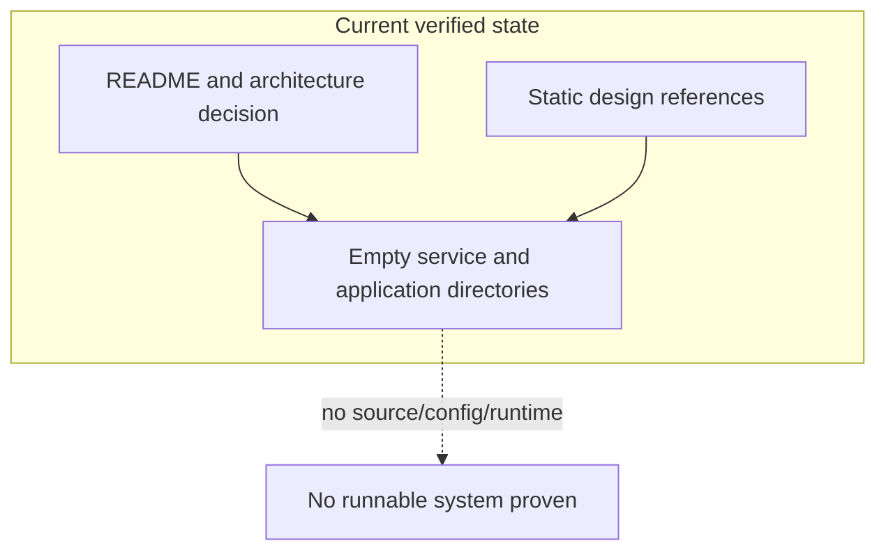
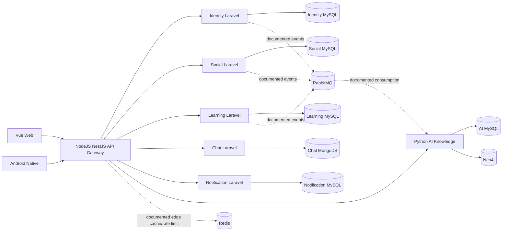

# Current System

> **Đối soát Foundation 2026-09-16:** đã có source, model/migration, Web/Gateway build và HTTP health local PASS. Các nhận định “chưa có source” bên dưới là snapshot cũ, không còn dùng cho Foundation. Xem [bằng chứng hiện tại](../../Base_du_an/FOUNDATION_AUDIT_2026-09-16.md). Chưa xác minh business flow/auth hay migration database; không nâng feature lên VERIFIED_IMPLEMENTED.

## 1. Executive Summary

### Current implemented state

`social_networks/` hiện là một **architecture skeleton/documentation base**, không phải một hệ thống có runtime đã triển khai. Nó có các service boundary bằng thư mục và README, hai HTML mock có nội dung, tám HTML placeholder, cùng một quyết định kiến trúc ưu tiên cao. Không có source framework, database schema/migration, API route, queue worker, realtime code, dependency manifest, test, Docker configuration hoặc CI/CD.

Do đó, không feature nào được xếp `VERIFIED_IMPLEMENTED`. Hai mock UI chỉ đủ bằng chứng cho `VERIFIED_PARTIAL` ở tầng prototype giao diện, không phải cho workflow nghiệp vụ.

### Intended state được chốt bằng tài liệu

Tài liệu `Cấu trúc cuối cùng.md` quy định target là microservices trong monorepo: Vue web và Android Native gọi NodeJS/NestJS Gateway; Gateway giao tiếp với năm Laravel services và một Python AI service. Giao tiếp synchronous được thiết kế là REST/JSON; asynchronous là RabbitMQ. Đây là **intended architecture**, không phải current runtime.

## 2. Runtime Components

| Component | Current status | Runtime evidence | Kết luận |
| --- | --- | --- | --- |
| Web runtime | `NOT_FOUND` | Không có Vue source/package/build config. | Không thể chạy web app. |
| Mobile runtime | `NOT_FOUND` | Không có Android/Gradle source. | Không thể chạy mobile app. |
| Gateway runtime | `NOT_FOUND` | Không có NestJS project/package config. | Không có entry point client API. |
| Business service runtime | `NOT_FOUND` | Không có Laravel project/composer config/artisan/routes. | Không có backend service thực thi. |
| AI runtime | `NOT_FOUND` | Không có FastAPI/Flask/worker/dependency config. | Demo Python ngoài phạm vi không phải service. |
| Database/cache/broker runtime | `NOT_FOUND` | Không có Compose/env/config. | Không có backing infrastructure thực thi. |

## 3. Application Boundaries

### Current state

Không đủ source/deployment evidence để phân loại một application runtime là monolith, modular monolith, microservices hay hybrid. Phân loại đúng là **`UNKNOWN` — no deployable implementation**.

### Documented target boundary

`DOCUMENTED_NOT_IMPLEMENTED`: microservices in monorepo. Mỗi service sở hữu database/migration riêng; không cross-database join/FK; web/mobile không gọi service trực tiếp.

| Boundary | Sở hữu được tài liệu mô tả | Data store được tài liệu mô tả |
| --- | --- | --- |
| `identity-service` | identity, profile, organization, roles, permissions, sessions/tokens | MySQL riêng |
| `social-service` | posts, media metadata, comments, reactions, upvote, reputation | MySQL riêng |
| `learning-service` | courses, lessons, documents, learning progress, Q&A/FAQ | MySQL riêng |
| `chat-service` | conversations, members, messages, read state | MongoDB riêng |
| `notification-service` | in-app notification, push devices, delivery history | MySQL riêng |
| `ai-knowledge-service` | AI pipeline, metadata/chunks, curation, KG, expert finder, recommendation, hybrid search | MySQL riêng + Neo4j |

## 4. Service Communication

### Verified current communication

`NOT_FOUND`. Không có source, config, route, event schema, client library, worker hoặc deploy artifact chứng minh bất kỳ call/event nào.

### Documented target communication

| Source | Target | Protocol/transport | Purpose | Status |
| --- | --- | --- | --- | --- |
| Web/Mobile | API Gateway | HTTPS/REST; realtime boundary khi cần | Client entry point duy nhất | `DOCUMENTED_NOT_IMPLEMENTED` |
| API Gateway | Business/AI services | REST/JSON | Forward/edge concerns, không business logic | `DOCUMENTED_NOT_IMPLEMENTED` |
| Service | Service | REST/JSON | Dữ liệu cần phản hồi ngay | `DOCUMENTED_NOT_IMPLEMENTED` |
| Service | RabbitMQ | Event | Đồng bộ/read model hoặc task async | `DOCUMENTED_NOT_IMPLEMENTED` |
| RabbitMQ | Consumer | Event | Consume idempotent task/event | `DOCUMENTED_NOT_IMPLEMENTED` |

## 5. External Dependencies

Không có dependency manifest hay runtime configuration để xác minh dependency thực tế.

| Dependency | Evidence | Current conclusion |
| --- | --- | --- |
| Pusher | Tài liệu cũ và sơ đồ cũ | `DOCUMENTED_NOT_IMPLEMENTED`; target cần chốt. |
| Firebase/FCM | Workbook/tài liệu cũ | `DOCUMENTED_NOT_IMPLEMENTED`; target cần chốt. |
| Algolia | Workbook/tài liệu cũ | `DOCUMENTED_NOT_IMPLEMENTED`; không khớp ownership Hybrid Search hiện hành. |
| LLM/embedding provider | Đề tài và proposal cũ chỉ nêu lựa chọn | `UNKNOWN`; không provider, key, model hay prompt source. |
| Object storage (MinIO/S3) | Quyết định kiến trúc | `DOCUMENTED_NOT_IMPLEMENTED`. |

## 6. Current State Diagram

## 7. Documented Target Diagram

All arrows in this diagram are `DOCUMENTED_NOT_IMPLEMENTED`; none are verified runtime paths.

## Evidence

- `README.md`
- `Cấu trúc cuối cùng.md`, especially sections 3–9
- `apps/*/README.md`, `gateway/api-gateway/README.md`, `services/*/README.md`
- Full `social_networks` file inventory conducted 2026-09-10
