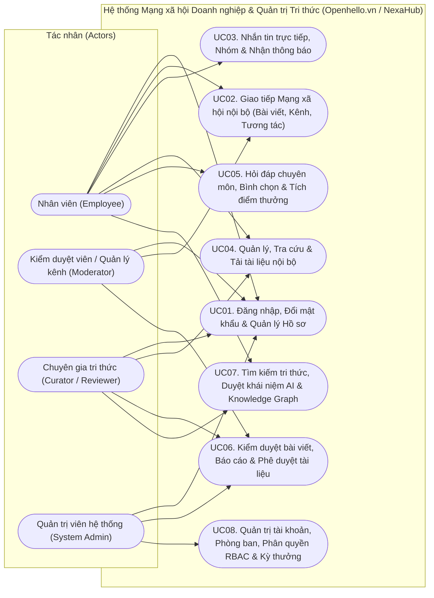
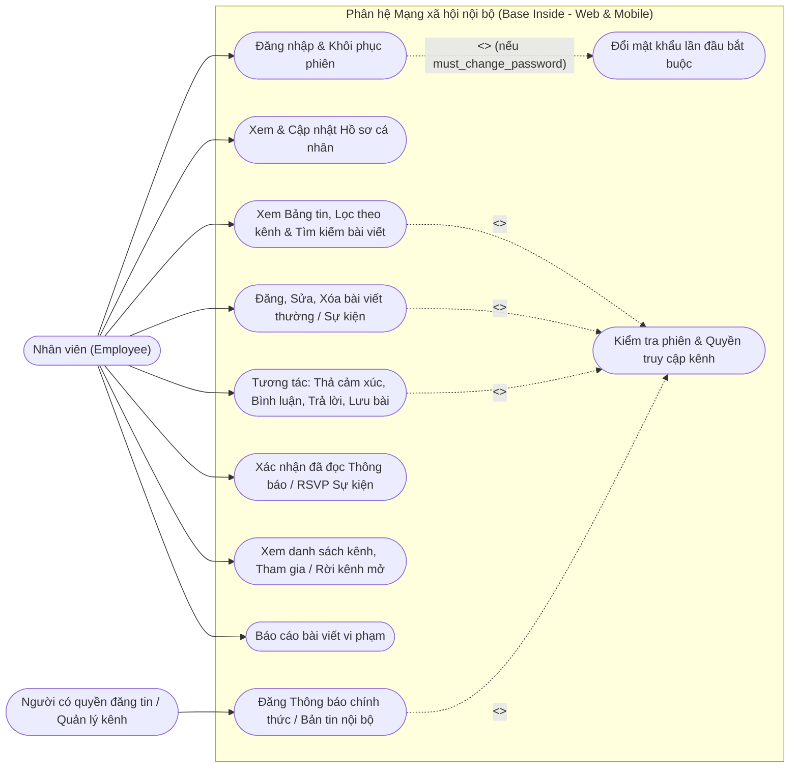
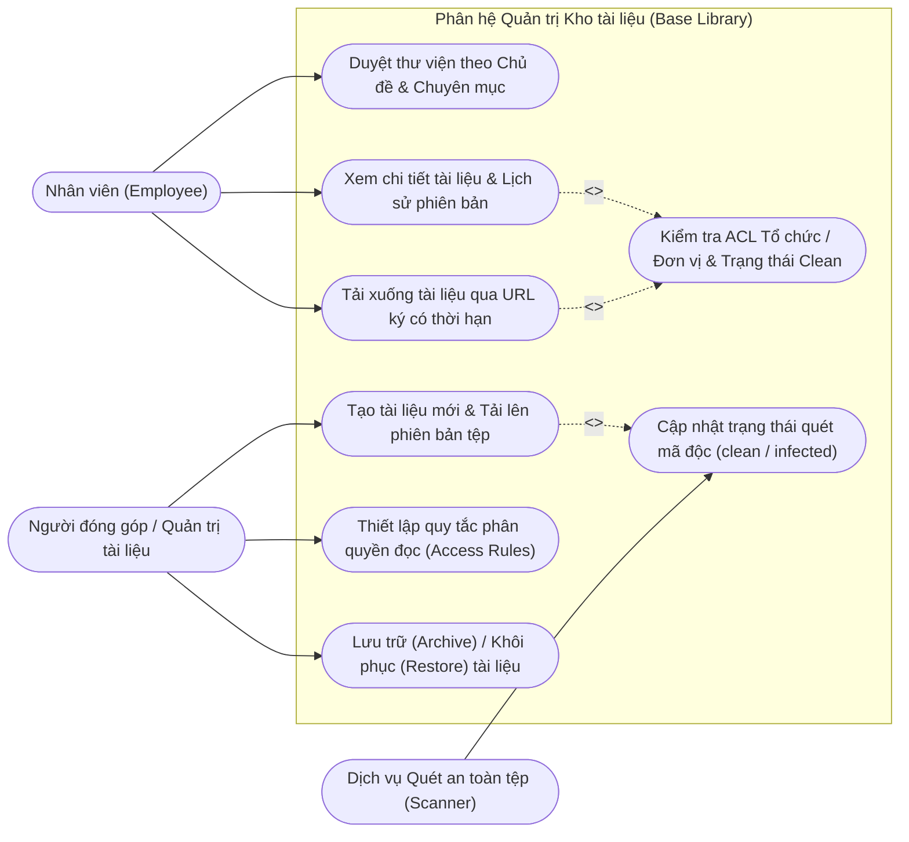
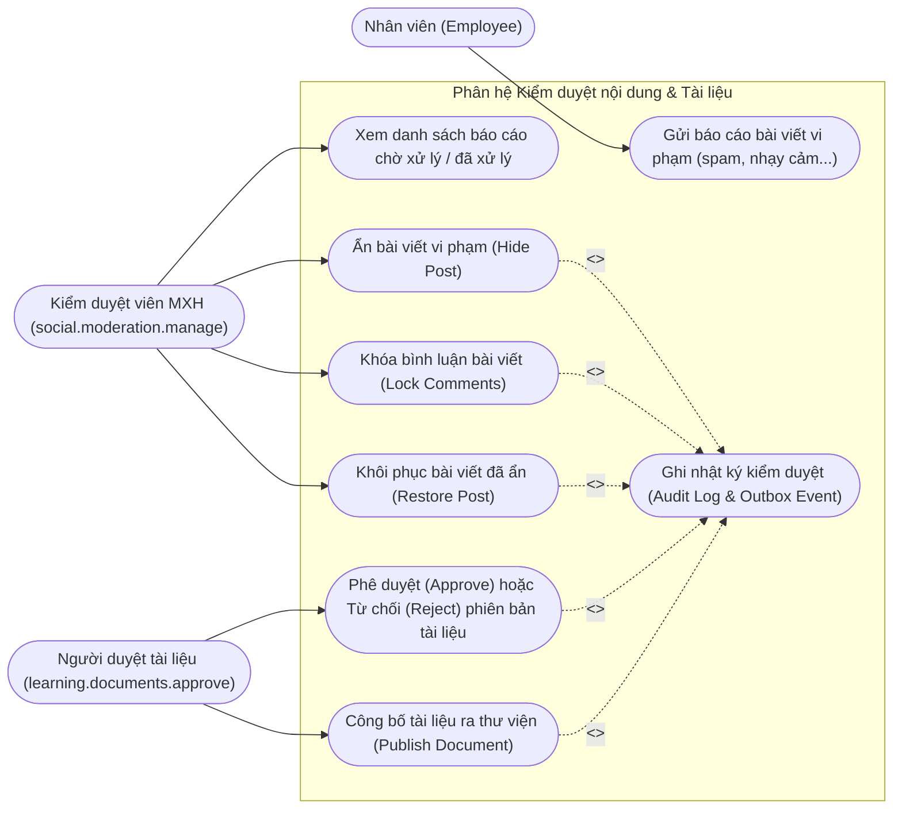
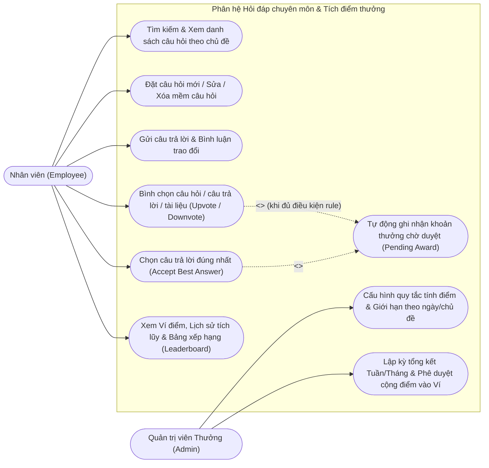
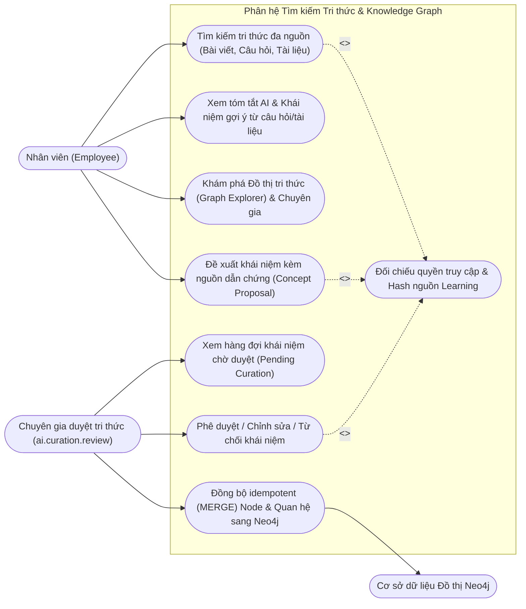
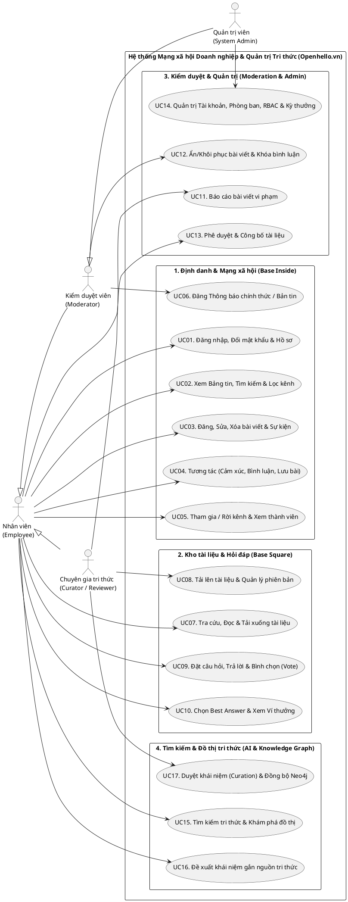

# Bộ Biểu đồ Use Case Tổng quát & Phân rã (Dùng cho Báo cáo ĐATN)

Tài liệu này cung cấp đầy đủ các **Biểu đồ Use Case tổng quát và phân rã** (kèm quan hệ `<<include>>`, `<<extend>>` và phân nhóm Actor) theo chuẩn báo cáo Đồ án Tốt nghiệp, đồng thời cung cấp **Bảng tra cứu toàn bộ đường dẫn nguồn trong dự án** cho các mục 1, 2, 3, 4.

---

## 1. Biểu đồ Use Case Tổng quát Toàn hệ thống (System-Level Use Case)

---

## 2. Các Biểu đồ Use Case Phân rã theo 5 Phân hệ Nghiệp vụ

### 2.1. Phân rã 1: Mạng xã hội nội bộ & Hồ sơ (Identity & Base Inside)

---

### 2.2. Phân rã 2: Quản trị Kho tài liệu (Base Library)

---

### 2.3. Phân rã 3: Kiểm duyệt nội dung (Moderation & Governance)

---

### 2.4. Phân rã 4: Hỏi đáp chuyên môn & Cơ chế thưởng (Base Square Q&A & Rewards)

---

### 2.5. Phân rã 5: Tìm kiếm tri thức, AI Curation & Knowledge Graph (AI & Neo4j)

---

## 3. Mã PlantUML chuẩn (Để dán vào PlantUML / Draw.io xuất ảnh chèn báo cáo Word)

Nếu bạn dùng **PlantUML** hoặc **Draw.io** (`Arrange -> Insert -> Advanced -> PlantUML` hoặc `Mermaid`) để xuất ảnh độ phân giải cao cho báo cáo Word, có thể dùng trực tiếp khối PlantUML dưới đây:

