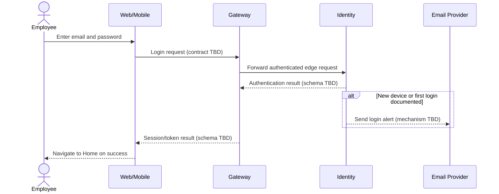
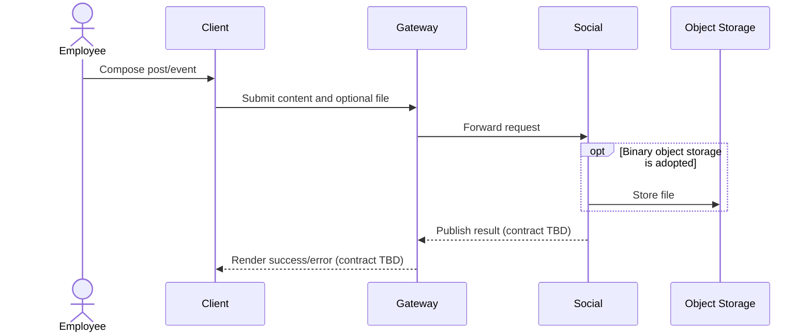
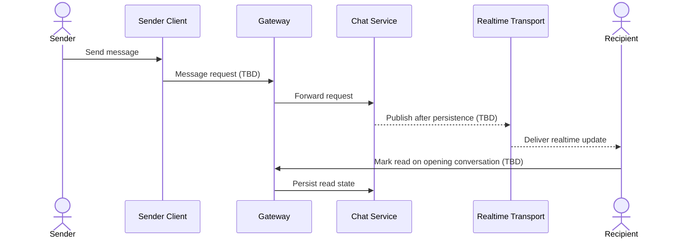
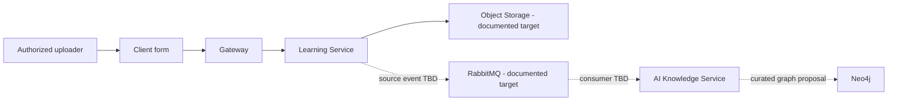

# User Flows

## Status

All flows are **documented target flows**. No end-to-end execution is verified because the repository has no runnable application, API or database. Steps marked `SPEC_GAP` need a product/technical decision before implementation.

## FLOW-AUTH-001 — Login

| Item | Detail |
| --- | --- |
| Actor | Unauthenticated employee |
| Entry point | Login page/mock form |
| Services | Intended: Gateway -> Identity; email service only for new-device alert |
| DB changes | `UNKNOWN` — no schema/migration |
| Events/queue | `UNKNOWN` |
| Failure cases | Missing fields, invalid credential, ineligible/locked account, mail delivery failure; exact behavior unknown. |

**Evidence:** workbook “Tổng quan” rows 4–9; `02-login.html`; Identity/Gateway READMEs.

## FLOW-AUTH-002 — Register and verify email

| Item | Detail |
| --- | --- |
| Actor | Person without account |
| Entry point | Registration screen `NOT_FOUND` |
| Steps | Submit company email/password -> check eligibility -> send code -> verify code -> show success -> return to Login. |
| Services / DB / events | Intended Identity + email provider; exact data and async behavior `UNKNOWN`. |
| Failure cases | Ineligible/existing email, invalid/expired code, resend limit, email failure — unresolved. |

**Evidence:** workbook rows 10–13.

## FLOW-SOCIAL-001 — Create and publish a post/event

| Item | Detail |
| --- | --- |
| Actor | Authenticated employee |
| Entry point | Social composer `NOT_FOUND` |
| Steps | Select post/event -> enter content -> optionally attach valid image -> validate -> publish -> feed updates. |
| Documented validations | Image extension `jpg`, `jpeg`, `png`; maximum 2 MB. |
| Intended services | Gateway -> Social; object storage/Notification/AI may later participate but no contract proves this. |
| DB changes / events / jobs | `UNKNOWN` |
| Failure cases | Invalid file, upload/publish failure, moderation hold, audience restriction, event-date validation all unresolved. |

**Evidence:** workbook rows 43–48; `services/social-service/README.md`; architecture decision section 8.

## FLOW-SOCIAL-002 — Browse feed and comments

| Item | Detail |
| --- | --- |
| Actor | Authenticated employee |
| Entry point | Social Feed screen (currently placeholder) |
| Steps | Load 6 feed items -> expand truncated content if >150 chars -> load comments newest-first, 6 per request -> submit a max-255-character comment -> load more. |
| Services / DB / events | Intended Gateway -> Social; all schema/events/realtime paths `UNKNOWN`. |
| Failure cases | Empty, deleted/hidden post, permission change, stale pagination cursor, failed comment submit. |

**Evidence:** workbook rows 43–48; `03-social-feed.html`.

## FLOW-SOCIAL-003 — Admin moderation

| Item | Detail |
| --- | --- |
| Actor | Administrator (actual role/permission mapping unknown) |
| Entry point | Approval area `NOT_FOUND` |
| Steps | Load user-reported/AI-flagged post -> review -> hide or delete. |
| DB changes / audit / notification | `UNKNOWN`; should be designed before implementation. |
| Failure cases | Unclear flag reason, wrong action, appeal/restore, competing reviewers. |

**Evidence:** workbook rows 40–42.

## FLOW-NOTIF-001 — Browse notifications

| Item | Detail |
| --- | --- |
| Actor | Authenticated employee |
| Entry point | Notification bell |
| Steps | Open dropdown -> load six newest notifications -> scroll/load more. |
| Unknowns | Event producers, notification model, read state, destination behavior, delivery system, errors. |

**Evidence:** workbook rows 31–33; `01-welcome.html` static unread indicator.

## FLOW-CHAT-001 — Direct chat and read state

| Item | Detail |
| --- | --- |
| Actor | Two users who are friends according to workbook rule |
| Entry point | Messenger screen (placeholder) |
| Steps | Select eligible person/conversation -> load history -> send/receive realtime message -> display latest time/unread count -> opening conversation marks unread as read. |
| Intended services | Gateway -> Chat (MongoDB source of truth); Notification/realtime transport as separate design decisions. |
| DB changes / events | `UNKNOWN` |
| Failure cases | User offline, connection loss, duplicate delivery, group membership, excessive history, read-race. |

**Evidence:** workbook rows 53–60; `services/chat-service/README.md`; architecture decision section 8.

## FLOW-LEARN-001 — Ask and browse Q&A

| Item | Detail |
| --- | --- |
| Actor | Authenticated employee |
| Entry point | Edu Home -> Ask Question / Q&A List |
| Steps | Choose topic/category -> enter title/body -> publish -> browse questions by creation date -> open detail. List loads 6 more entries per request. |
| Data shown | Title, author, creation time, question body, answer count, vote count. |
| Intended services | Gateway -> Learning; Identity author summary; possible AI/Notification are unconfirmed. |
| DB changes / events | `UNKNOWN` |
| Failure cases | Invalid taxonomy, empty fields, duplicate/related question, no results, authorization failure. |

**Evidence:** workbook rows 69–98; `services/learning-service/README.md`.

## FLOW-LEARN-002 — View question detail and answers

| Item | Detail |
| --- | --- |
| Actor | Authenticated employee |
| Entry point | Click question title |
| Steps | Show topic/category and author info -> show vote/title/body/answers -> show other questions by author. |
| Ambiguity | Workbook calls a list “bình luận” newest-first while screen describes answers. Whether comments are distinct from answers is `SPEC_GAP`. |
| DB changes / events / failures | Answer creation, vote transitions, acceptance, moderation and API behavior are `UNKNOWN`. |

**Evidence:** workbook rows 100–105.

## FLOW-DOC-001 — Upload, browse and obtain document

| Item | Detail |
| --- | --- |
| Actor | Employee; uploader authority unknown |
| Entry point | Edu Library |
| Steps | Select field/category -> search/browse -> optionally enter title/category and attach `docx`/`pdf` -> upload -> display metadata card -> select document. |
| Intended services | Gateway -> Learning -> object storage; AI Knowledge processing is a target concept. |
| DB changes / events | `UNKNOWN` |
| Failure cases | Unsupported/malicious/oversized file, scan failure, duplicate/version conflict, access denied, broken download/preview. |
| Ambiguity | Workbook says clicking downloads file and also says navigate to new “loading” document screen; desired UX must be decided. |

**Evidence:** workbook rows 112–119; `Cấu trúc cuối cùng.md` sections 4, 6, 8; AI/Learning READMEs.

## FLOW-AI-001 — Knowledge extraction, curation and retrieval

| Item | Detail |
| --- | --- |
| Actors | System AI processor; curator/admin/expert; knowledge consumer |
| Entry point | Intended source document/post ingestion; actual trigger `UNKNOWN` |
| Steps | Extract source text -> normalize/chunk -> propose entities/relations/embeddings -> human approve/edit -> persist approved KG -> use for search, expert finder and recommendations. |
| Intended services | AI Knowledge, MySQL metadata, Neo4j; storage/RabbitMQ/LLM provider need decisions. |
| Data changes / failure cases | All canonical entities, curation state, retry, cost, evaluation and deletion-sync behavior are `SPEC_GAP`. |

**Evidence:** `Mô tả đề tài.docx`; `knowledge_graph_detail.md`; `services/ai-knowledge-service/README.md`; `Cấu trúc cuối cùng.md`.

## Flow Coverage Gap

There is no documented flow for password reset, logout, role/department administration, friendship/follow lifecycle, post reactions/upvotes, courses/lessons/progress, user/device notification registration, content deletion/retention, audit access, search authorization or operational recovery. See [OPEN_QUESTIONS.md](../OPEN_QUESTIONS.md).
