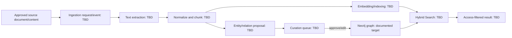

# AI and Knowledge Graph Specification

## Current Implementation Assessment

| Area | Current finding | Status |
| --- | --- | --- |
| Product Python runtime | No Python project, dependency manifest, API, worker, model client or entry point inside `services/ai-knowledge-service`. | `NOT_FOUND` |
| PHP/Python communication | No HTTP client, broker producer/consumer, CLI integration or contract. | `NOT_FOUND` |
| AI jobs | No job model, queue, retry, scheduler or dead-letter handling. | `NOT_FOUND` |
| Embeddings/vector store | No provider/model/vector schema/index/query. | `NOT_FOUND` |
| Neo4j integration | No driver, Cypher query, node type, relation type or sync code. | `NOT_FOUND` |
| Prompt management | No prompt file or versioning. | `NOT_FOUND` |
| Evaluation/observability/cost controls | No implementation/configuration. | `NOT_FOUND` |
| Standalone graph demo | `test_knowledge_graph/demo_knowledge_graph.py` builds NetworkX graph from hard-coded mock entities/tags and saves PyVis HTML. | `VERIFIED_IMPLEMENTED` only as a demo, not product runtime |

## Documented Target Responsibilities

The AI Knowledge Service is documented to own AI pipeline state, source/document metadata, chunk metadata, AI suggestions, curation queue, Knowledge Graph, Expert Finder, learning recommendation and Hybrid Search. MySQL stores metadata/pipeline state; Neo4j stores the graph.

| Capability | Evidence | Current status |
| --- | --- | --- |
| Text extraction / preprocessing | Project proposal describes Vietnamese NLP and file parsing. | `DOCUMENTED_NOT_IMPLEMENTED` |
| Chunking | Architecture proposal describes chunking. | `DOCUMENTED_NOT_IMPLEMENTED` |
| Entity/relation extraction | Proposal names KeyBERT/TF-IDF/LLM options. | `DOCUMENTED_NOT_IMPLEMENTED` |
| Curation approval | Proposal requires admin/expert approval before official graph persistence. | `DOCUMENTED_NOT_IMPLEMENTED` |
| Knowledge Graph | AI README and proposals identify Neo4j. | `DOCUMENTED_NOT_IMPLEMENTED` |
| Expert Finder | AI README/project proposal. | `DOCUMENTED_NOT_IMPLEMENTED` |
| Learning recommendation | AI README/project proposal. | `DOCUMENTED_NOT_IMPLEMENTED` |
| Hybrid Search | AI README and architecture decision say ownership is AI Knowledge Service at present. | `DOCUMENTED_NOT_IMPLEMENTED` |

## Evidence Hierarchy and Conflicts

`Cấu trúc cuối cùng.md` is priority for architecture. It chooses MySQL for AI metadata and Neo4j for Knowledge Graph and explicitly rejects `pgvector` in favor of the current MySQL decision. Older proposals mention PostgreSQL/pgvector, Chroma, Algolia, FastAPI/Flask and named LLMs; these are alternatives, not approved implementation choices.

## Intended Data Flow

All steps/edges are `DOCUMENTED_NOT_IMPLEMENTED`; the diagram is a proposed analysis boundary, not source behavior.

## Knowledge Graph Concept Model

Documents describe three broad node groups: people/experts/departments, expertise/tags/concepts and knowledge documents/Q&A. They suggest semantic relationships such as a knowledge item being tagged with an expertise, an author contributing a document, and expertise/reputation informing Expert Finder.

| Model element | Current schema | Approved semantic contract |
| --- | --- | --- |
| Node labels | `UNKNOWN` | `TODO / SPEC_GAP` |
| Relation types/directions | `UNKNOWN` | `TODO / SPEC_GAP` |
| Identifier mapping to service records | `UNKNOWN` | `TODO / SPEC_GAP` |
| Properties/provenance/confidence | `UNKNOWN` | `TODO / SPEC_GAP` |
| Curation state/audit/reversibility | `UNKNOWN` | `TODO / SPEC_GAP` |
| Deletion/access-right propagation | `UNKNOWN` | `TODO / SPEC_GAP` |

The `test_knowledge_graph` demo’s node strings, colors and implicit undirected edges are illustrative mock data. They must not be adopted as production ontology without an ADR and owner approval.

## AI Functional Boundaries

### FR-AI-001 — Ingestion and curation

Documented objective: turn internal document, Q&A and potentially social content into proposed tags/entities/relations; a curator approves or edits the proposal before graph persistence.

Required but unresolved:

- Accepted sources, MIME types, language and size limits.
- Source authorization and least-privilege content fetch.
- Extraction/OCR/parsing library selection and sandboxing.
- Chunking strategy, overlap, version/model linkage and reprocessing rules.
- Provider/model, fallback, prompt contract, structured-output validation and redaction.
- Curation role, queue UX, confidence threshold, approval/edit/reject/revoke state machine.
- Graph write idempotency, provenance, rollback and source deletion synchronization.

### FR-AI-002 — Search, expert finding and recommendation

Documented objective: combine semantic/vector retrieval and graph relationships to find documents/Q&A/experts and recommend learning items.

Required but unresolved:

- Vector index/store decision compatible with the chosen MySQL/Neo4j architecture.
- Retrieval/ranking/fusion algorithm and evaluation dataset/metrics.
- Authorization filtering before and after retrieval; no cross-department leakage.
- Citation/source attribution and no-result behavior.
- Expert score definition, reputation source owner, opt-in, notification throttle and fairness rules.
- User consent/feedback and recommendation explainability.

## Prompt and Model Management

No prompt, provider, embedding model, LLM endpoint, cost limit, time-out, fallback or evaluation exists. Before any model call is enabled, define a versioned prompt/model registry with:

| Required control | Status |
| --- | --- |
| Purpose and allowed inputs per task | `TODO / SPEC_GAP` |
| Data classification/redaction policy | `TODO / SPEC_GAP` |
| Prompt/template version and structured output schema | `TODO / SPEC_GAP` |
| Provider/model/region and retention terms | `TODO / SPEC_GAP` |
| Per-request correlation/source/model IDs | `TODO / SPEC_GAP` |
| Token/cost/timeout/retry limits | `TODO / SPEC_GAP` |
| Offline/failed-provider behavior | `TODO / SPEC_GAP` |
| Golden dataset, evaluator and release gate | `TODO / SPEC_GAP` |

## AI Security Requirements

The project’s internal knowledge nature makes the following design gates mandatory before implementation:

1. Enforce source-document authorization in every AI retrieval and graph/search result.
2. Do not send classified content to an external model/provider until data transfer, retention and approval are defined.
3. Treat document text, retrieved content and user queries as untrusted; defend against prompt injection and tool/data exfiltration.
4. Keep curation/audit provenance so an approved graph fact can be traced to source and model/proposal version.
5. Apply rate, size, content-type and malware scanning controls before extraction.
6. Ensure deletion, access revocation and source updates propagate to chunks, index and graph.

## Current Gaps

The AI/Knowledge Graph program has an ambitious documented target but no product implementation artifacts. Its immediate next deliverable should be a limited, access-controlled **document ingestion + curation contract**, not an unbounded RAG/recommendation feature. See [15-target-architecture.md](15-target-architecture.md), [OPEN_QUESTIONS.md](../OPEN_QUESTIONS.md) and ADR-004/ADR-005.

## Evidence

- `services/ai-knowledge-service/README.md`
- `Cấu trúc cuối cùng.md`, sections 3, 4, 6, 8
- `Mô tả đề tài.docx`, section 2.2.1
- `knowledge_graph_detail.md`
- `ananylics/system_architecture.md` and `system_architecture_report.md` (older proposals)
- `test_knowledge_graph/demo_knowledge_graph.py`
