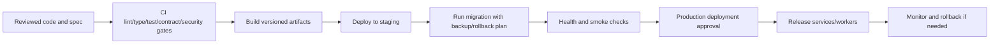

# Deployment and Operations Specification

> **Cập nhật 2026-09-16:** ưu tiên [chạy local trực tiếp](../../Base_du_an/LOCAL_DEVELOPMENT.md) bằng môi trường đã cài; sau khi local đạt mới [build/run Docker](../../Base_du_an/DOCKER_DEVELOPMENT.md). Docker không là điều kiện bắt đầu phát triển local. Ghi bằng chứng hai cách riêng; mô tả Docker-first cũ bên dưới được thay thế bởi quyết định này.

## Current Deployment State

No deployment implementation was found.

| Area | Current finding |
| --- | --- |
| Development environment | `NOT_FOUND`: no Docker Compose, Dockerfile, `.env.example` or startup script. |
| Staging environment | `UNKNOWN`: no configuration/docs. |
| Production environment | `UNKNOWN`: no configuration/docs. |
| CI/CD | `NOT_FOUND`: no pipeline config. |
| Image/build manifests | `NOT_FOUND`. |
| Database migrations | `NOT_FOUND`. |
| Scheduler/queue workers | `NOT_FOUND`. |
| Gateway/reverse proxy/TLS | `NOT_FOUND`. |
| Backup/restore runbook | `NOT_FOUND`. |
| Health checks | `NOT_FOUND`. |

## Documented Development Target

The first documented implementation step is local Docker Compose for MySQL, MongoDB, Redis, RabbitMQ, Neo4j and MinIO. The infrastructure directory expressly says no such config exists yet. Kubernetes, service mesh, CQRS/Event Sourcing and premature infrastructure trees are explicitly out of current base-stage scope.

| Runtime component | Documented target | Status |
| --- | --- | --- |
| API Gateway | NodeJS/NestJS | `DOCUMENTED_NOT_IMPLEMENTED` |
| Core services | Individual Laravel services | `DOCUMENTED_NOT_IMPLEMENTED` |
| AI Knowledge | Python service | `DOCUMENTED_NOT_IMPLEMENTED` |
| Datastores | Dedicated MySQL schemas, Chat MongoDB, Neo4j, Redis | `DOCUMENTED_NOT_IMPLEMENTED` |
| Messaging/storage | RabbitMQ, MinIO/S3 compatible storage | `DOCUMENTED_NOT_IMPLEMENTED` |

## Proposed Environment Model

This is a **proposed operational baseline**, pending owner decisions; it is not existing infrastructure.

| Environment | Purpose | Minimum controls |
| --- | --- | --- |
| Local development | Developer integration | Reproducible compose, fake/dev secrets, isolated data volumes, health checks. |
| Staging | Production-like verification | Separate secrets/data, migration rehearsal, contract/E2E/security smoke, observability and rollback exercise. |
| Production | Controlled user traffic | Managed secrets, backups/restore drills, least-privilege networking, monitoring/alerts, change approval. |

## Future Deployment Flow

Every step is `PROPOSED`; no CI or deploy implementation currently exists.

## Required Deployment Record per Release

| Field | Requirement |
| --- | --- |
| Release/version | Immutable artifact version and source revision. |
| Components | Gateway/services/client/worker/image versions. |
| Config/secrets | Environment keys documented by name only; values never in spec. |
| Data change | Owning-service migration, backward compatibility, backup and rollback procedure. |
| Async impact | Queue/event schema compatibility, worker rollout order, replay/DLQ plan. |
| Health checks | Readiness/liveness and key dependency checks. |
| Validation | Automated gates and manual smoke path. |
| Rollback | Trigger, owner, exact rollback compatibility notes. |
| Observability | Dashboards, alerts and correlation IDs ready before traffic. |

## Initial Deployment Gaps

1. Select hosting/network/TLS/domain strategy.
2. Create service-specific build manifests only when those services are scaffolded.
3. Define configuration contract and secret store.
4. Decide image registry, migration runner, worker process manager and cron/scheduler responsibility.
5. Define backup/restore for each MySQL schema, MongoDB, Neo4j and object storage.
6. Define staging parity and test data privacy.
7. Establish CI quality gates after tests/contracts exist.

## Evidence

- `infrastructure/docker/README.md`
- `Cấu trúc cuối cùng.md`, sections 8, 10 and 11
- Repository inventory: no Docker/CI/deploy/config artifacts found
