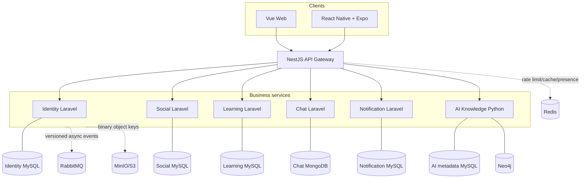

# Target Architecture

## Status and Decision Basis

This is a **proposed delivery architecture** constrained by `Cấu trúc cuối cùng.md`, the project’s priority architectural decision. It deliberately retains the documented microservice boundaries and avoids a speculative rewrite. None of its components is currently implemented.

## Context

The product target is an enterprise social, learning and knowledge-management platform with internal identity, content, documents, realtime messaging/notification and a curated AI Knowledge Graph. The actual repository is a base skeleton, so the design must optimize for incremental implementation, testability and operational simplicity rather than immediate full-scale complexity.

## Goals

1. Preserve service data ownership and a Gateway-only client boundary.
2. Deliver thin, testable vertical slices in documented implementation order.
3. Keep sensitive enterprise knowledge access-controlled throughout storage, search and AI processing.
4. Use asynchronous events only where a durable/slow cross-boundary action requires them.
5. Make every new feature traceable to FR, API/event, data ownership, tests and deployment impact.

## Constraints

| Constraint | Source |
| --- | --- |
| Microservices, not modular monolith, unless owner changes decision. | Architecture decision section 3. |
| Web Vue 3/TypeScript/Tailwind; mobile React Native + Expo. | Architecture decision section 3. |
| Gateway NodeJS/NestJS; Laravel core services; Python AI. | Architecture decision section 3. |
| Separate service databases; no cross-service joins/FKs. | Architecture decision sections 4–5. |
| MySQL for applicable services/AI metadata; MongoDB Chat; Neo4j KG. | Architecture decision section 4. |
| REST synchronous, RabbitMQ asynchronous; contracts versioned. | Architecture decision section 6. |
| No Kubernetes/service mesh/CQRS/Event Sourcing prematurely. | Architecture decision section 10. |

## Proposed Architecture

## Component Responsibilities

| Component | Responsibility | Explicit non-responsibility |
| --- | --- | --- |
| Web/Mobile | UX, local display state, Gateway client, user interaction. | Direct service/database access; business-authoritative decisions. |
| Gateway | Routing, edge auth verification, rate limit, correlation ID, error envelope, optional realtime boundary. | Business data persistence/ownership or cross-service business logic. |
| Identity | Identity, profile, organization/RBAC and token issuance. | Other services’ content/message data. |
| Social | Social content and interactions. | Identity truth or Learning/Chat records. |
| Learning | Courses/lessons/documents/Q&A/progress. | AI graph persistence/Identity truth. |
| Chat | Conversation/message/read state in MongoDB. | Treating realtime transport as truth. |
| Notification | Durable notifications/device registration/delivery. | Authoritative source of social/learning/chat events. |
| AI Knowledge | Authorized ingestion, AI metadata, curation, KG/search/recommendation. | Bypassing source-service authorization or becoming source of original documents. |

## Data and Communication

- Use service-local stores and UUID references across boundaries.
- Use authenticated internal REST only when the request must synchronously decide a user interaction.
- Use versioned RabbitMQ events for durable propagation/slow work; producers should employ an outbox once persistent data exists; consumers must be idempotent.
- Place binary content in object storage and persist only metadata/key in the owning service.
- Build local read models only when a measured UX/query need justifies eventual consistency.

## Realtime Proposal

Start with a single chosen realtime transport after an ADR: managed Pusher **or** a Gateway WebSocket boundary. In both options Chat writes to MongoDB before emitting an update. Notification delivery must remain durable and replayable even if realtime delivery fails. Channel authorization, reconnect behavior and push policy are release gates.

## Search and AI Proposal

Phase AI work as: source authorization -> document ingestion -> human curation -> Neo4j projection -> access-filtered retrieval -> measured hybrid search -> expert/recommendation. The project has not chosen a vector-store/provider/fusion algorithm compatible with MySQL/Neo4j; that requires an ADR rather than importing an older pgvector/Algolia proposal.

## Deployment and Scaling Strategy

Start with Docker Compose for local development. Build/deploy services independently only after their own code/config/tests exist. Scale Gateway, stateless service APIs and AI workers independently based on real load; keep stateful stores backed up and observed. Kubernetes/service mesh is out of the current target until operational evidence requires it.

## Migration Strategy

1. Keep the skeleton and priority architecture document.
2. Deliver Gateway + Identity + Web login as the first vertical slice.
3. Add only service-local schema/migrations/contracts for that slice.
4. Add Social feed/post/comment or Learning Q&A as the next bounded slice.
5. Add Notification/Chat after event/realtime ADRs.
6. Introduce AI with a curated document ingestion pilot, then retrieval/recommendation.
7. Introduce Mobile once Gateway contracts for auth/feed/chat are stable.

No move to a monolith, cross-database coupling, standalone search service, pgvector, or a specific realtime/LLM provider is implied by this migration plan.
