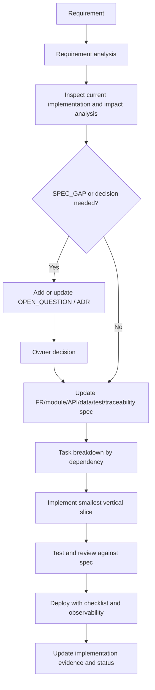

# Specification Change Workflow

> **Cập nhật 2026-09-16:** ưu tiên [chạy local trực tiếp](../Base_du_an/LOCAL_DEVELOPMENT.md) bằng môi trường đã cài; sau khi local đạt mới [build/run Docker](../Base_du_an/DOCKER_DEVELOPMENT.md). Docker không là điều kiện bắt đầu phát triển local. Ghi bằng chứng hai cách riêng; mô tả Docker-first cũ bên dưới được thay thế bởi quyết định này.

> **Theo dõi công việc từ 2026-09-15:** Đọc [README phase](README.md); cập nhật trạng thái và nhật ký trong file công việc của phase. `NEEDS_REVIEW` yêu cầu đối soát code trước khi chọn trạng thái. Các mô tả hiện trạng cũ không thay thế bằng chứng source.

## Principle

The spec is the single source of truth for **approved intent plus verified current state**. A code change and a spec change are one deliverable when behavior, contract, data, architecture, security, test or operation changes.

## New Feature Workflow



## Requirement Analysis Checklist

| Area | Questions that must be answered |
| --- | --- |
| Business | Actor, user outcome, preconditions, main/alternative flows, business rules, acceptance criteria. |
| Ownership | Which service owns the behavior and source data? Are cross-boundary read models/events needed? |
| API/event | Public/internal method/path/schema/error/auth, correlation ID, event schema/version/consumer. |
| Data | Service-local migration, IDs, indexes/access patterns, retention/delete and rollback. |
| Client | Page/navigation/permission/state/error/loading/empty/accessibility/mobile impact. |
| Security | Resource authorization, validation, file/secret/data classification, audit and AI risk. |
| Quality | Unit/contract/integration/E2E/security/performance tests and acceptance mapping. |
| Operations | Config, build, migration, worker, health, telemetry, rollback/backup impact. |

## Change Request Workflow

Use `CR-<NNN>` for a requirement/contract behavior change after a relevant spec exists.

```text
CR
  -> affected FR(s)
  -> affected module(s)
  -> affected API/event contract(s)
  -> affected DB schema/read model(s)
  -> affected UI/mobile flow(s)
  -> affected test(s)
  -> affected deployment/observability
  -> owner approval
  -> implementation and evidence update
```

Minimum CR record:

| Field | Content |
| --- | --- |
| CR ID / status / owner | Stable ID and decision authority. |
| Requested change / reason | Business-level change, not code-only wording. |
| Current evidence | Existing FR/API/code/test paths and behavior. |
| Impacted artifacts | Every spec, contract, migration, component and test. |
| Alternatives/risk | Compatibility, data, security, rollout and rollback risk. |
| Approval | Explicit decision, date and approver. |
| Delivery evidence | Actual files/tests/deploy result after implementation. |

## Status Update Rules

| Situation | Required status/action |
| --- | --- |
| Source/code proves a complete behavior and required tests | `VERIFIED_IMPLEMENTED`, link evidence. |
| Only one layer works, e.g. static UI or API missing data flow | `VERIFIED_PARTIAL`, name missing layers. |
| Requirement/design exists without implementation | `DOCUMENTED_NOT_IMPLEMENTED`. |
| Likely conclusion not confirmed | `INFERRED`, state rationale and do not code it as fact. |
| Evidence cannot answer | `UNKNOWN`, add OQ if it blocks work. |
| Decision/spec detail is missing | `TODO / SPEC_GAP`, stop affected implementation. |

## Review Against Spec

Before merge/release, verify:

1. Each changed behavior maps to an FR/CR and module owner.
2. Every changed API/event has a reviewed compatible contract.
3. Every data change is owner-local and migration/rollback safe.
4. Client calls Gateway only and resource authorization occurs in owner service.
5. Tests map to acceptance criteria and failures/permissions.
6. Async processing is idempotent/observable and consumer rollout is safe.
7. Security, logs/metrics, configuration and deployment notes are complete.
8. Traceability and implementation statuses cite actual files, not assumptions.

## ID Convention

| Type | Format | Examples |
| --- | --- | --- |
| Module | `MOD-<NAME>` | MOD-AUTH, MOD-SOCIAL, MOD-CHAT, MOD-EDU, MOD-AI |
| Functional requirement | `FR-<DOMAIN>-<NNN>` | FR-AUTH-001, FR-SOCIAL-001, FR-LEARN-001 |
| API | `API-<DOMAIN>-<NNN>` | API-AUTH-001 |
| Data | `DB-<AREA>` | DB-IDENTITY, DB-SOCIAL |
| Test | `TEST-<DOMAIN>-<NNN>` | TEST-CHAT-001 |
| Task | `TASK-<AREA>-<NNN>` | TASK-CORE-002 |
| Decision | `ADR-<NNN>` | ADR-003 |
| Change request | `CR-<NNN>` | CR-001 |
| Open question | `OQ-<NNN>` | OQ-020 |

Never renumber an ID once another spec, task, test or code artifact references it.
