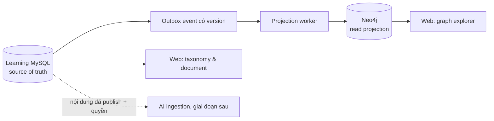

# P2 — Kế hoạch Learning làm nền cho AI và Knowledge Graph

[← Tổng quan Phase 2](README.md) · [Q&A và tài liệu](01-qa-documents.md) · [ADR AI](../adr/ADR-004-ai-integration.md) · [ADR Knowledge Graph](../adr/ADR-005-knowledge-graph.md)

> Kế hoạch đề xuất ngày 2026-09-19. Mục tiêu là dựng một nguồn tri thức có thể truy xuất và có provenance trước; AI chỉ được thêm sau khi dữ liệu, quyền và vòng đời nguồn đã kiểm chứng.

## Kết quả cần có trước khi làm AI

Một người dùng đã xác thực có thể xem taxonomy, đọc Knowledge Item đã publish và xem cây tri thức xác định được từ dữ liệu Learning. Mỗi node/quan hệ trên graph phải truy về ID/version của nguồn. Neo4j chỉ là projection có thể dựng lại, không phải nơi sở hữu dữ liệu gốc.

## Những gì đã có và còn thiếu

| Khu vực | Có trong source | Chưa đủ để gọi là triển khai |
|---|---|---|
| Learning data | Migration/model cho taxonomy, Q&A, document/version, outbox và demo seed | Chưa migration-test trên MySQL riêng, chưa có quy tắc nghiệp vụ hay API CRUD/read |
| API | `GET /api/v1/health` | Không có endpoint taxonomy, document, Q&A, event contract hay Gateway proxy |
| Graph | Demo tách rời; chưa có product Neo4j runtime | Chưa có ontology, constraint, projection, provenance, quyền truy cập hoặc deletion sync |
| AI | Chưa có runtime AI service | Chưa chọn provider, data policy, chunking, evaluation hoặc vector retrieval |

## Phạm vi MVP được khuyến nghị

Làm theo thứ tự dưới đây. Không đưa course, reward/coin, recommendation hay LLM chat vào MVP này.

| Lát cắt | Mục tiêu | Task hiện có liên quan | Điều kiện hoàn thành |
|---|---|---|---|
| S0 — Đối soát baseline | `DONE` 2026-09-19: migration/seed/model chạy MySQL test riêng, cleanup PASS; `learning_db` local có migration + demo seed | LEARN-DB-001–006 | Migrate lặp, seed lặp và health PASS; ghi chính xác schema còn thiếu |
| S1 — Taxonomy + Knowledge Item | `IN_PROGRESS`: topic/category, published document metadata/version, Gateway API và Base Square Vue đã có | LEARN-DB-001–006, LEARN-API-001–002 | API contract + tenant/visibility tests PASS; còn browser E2E tree/detail |
| S2 — Q&A làm nguồn tri thức | Question/answer published có tag/topic và lifecycle tối thiểu | LEARN-QA-001–010 | Ownership, cursor, vote và best-answer tests; event chỉ phát khi published |
| S3 — Contract projection | Outbox phát sự kiện versioned cho publish/update/archive/delete; consumer idempotent | LEARN-DOC-003/005, AI-GRAPH-004/005 | Re-run event không nhân bản graph; source/version/provenance truy được |
| S4 — Deterministic Knowledge Graph | Graph explorer cho Document, Question/Answer, Topic, Concept và Person reference | AI-GRAPH-001–009 | Neo4j constraints, projection idempotent và query concept → source → author PASS |
| S5 — AI-ready ingestion | Chuẩn bị text extraction, chunk, checksum, access scope và curation queue; chưa gọi model | AI-PROD-003–005 | Withdraw/delete làm tombstone source; reviewer thấy proposal và có thể reject |
| S6 — AI pilot | Chỉ sau phê duyệt, AI đề xuất concept/relation/chunk embedding để curator duyệt | AI-PROD-001–007 | Golden-set evaluation, source citation, access filter và rollback PASS |

## Ontology MVP đề xuất

Không cần mô hình rộng ngay từ đầu. Graph chỉ có các node và quan hệ sau:

| Node | Source owner | Khóa/provenance bắt buộc |
|---|---|---|
| `Organization` | Identity reference | `organization_id` |
| `Person` | Identity reference | `user_id`, không copy PII profile |
| `Topic` / `Category` | Learning | `topic_id` / `category_id` |
| `Document` / `DocumentVersion` | Learning | `document_id`, `version_id`, publish state |
| `Question` / `Answer` | Learning | `question_id` / `answer_id`, publish state |
| `Concept` | Learning curation record | normalized name, ontology version, curator/source |

Quan hệ MVP: `IN_TOPIC`, `IN_CATEGORY`, `AUTHORED_BY`, `HAS_VERSION`, `HAS_TAG`, `MENTIONS_CONCEPT`, `ANSWERED`, `DERIVED_FROM`.

Mỗi relation phải có `source_type`, `source_id`, `source_version`, `created_by` (`system` hoặc curator), `confidence` nếu là proposal, và `ontology_version`. Khi nguồn không còn publish/đã xóa/thu hồi quyền, projection phải xóa hoặc tombstone quan hệ tương ứng.

## Quyết định bắt buộc trước các lát cắt liên quan

| Quyết định | Cần trước | Mặc định đề xuất cho local MVP |
|---|---|---|
| OQ-022: taxonomy canonical | S1 | Admin quản lý topic/category; cố định một taxonomy demo ban đầu |
| OQ-030: quyền document/file | S1 document upload | Chỉ `internal`, text metadata/seed trước; chưa upload file thật khi chưa có object storage/scan |
| OQ-032 + OQ-039: trigger/revoke ingestion | S3 | Chỉ publish/update/archive/delete phát event; consumer idempotent và có tombstone |
| OQ-036: curation | S4/S5 | Proposal không tự thành “official”; một reviewer duyệt/reject trong pilot |
| OQ-037: ontology/provenance | S4 | Dùng ontology MVP ở tài liệu này, version `v1` |
| OQ-034/035/038/040: provider, retrieval, evaluation, search | S6 | Chưa gọi external AI/provider ở local MVP |

Các mặc định này chỉ để lập kế hoạch và làm deterministic projection; cần ghi quyết định chính thức vào ADR trước khi phát hành hoặc gửi nội dung nội bộ ra nhà cung cấp AI.

## Thứ tự triển khai đề xuất

1. **S0:** đối soát Learning Service trên MySQL test riêng; không reset `learning_db` đang dùng và không seed vào DB làm việc.
2. **S1:** hoàn thiện taxonomy và document metadata read-only; Gateway proxy + Web tree/detail.
3. **S2:** xây Q&A tối thiểu để thêm nguồn tri thức do con người tạo.
4. **S3–S4:** chốt event/provenance rồi dựng Neo4j deterministic từ seed/published records. Đây là mốc có “cây tri thức” trình diễn được.
5. **S5:** làm curation queue và deletion/reindex trước.
6. **S6:** chỉ bắt đầu AI provider, embeddings và hybrid search khi các OQ liên quan được phê duyệt.

## Lát cắt nên bắt đầu ngay

**S0 — Learning baseline reconciliation.** Việc này không cần Neo4j, object storage hay AI provider:

- đọc `.env` Learning nhưng không in secret;
- xác định database local và tạo database kiểm thử có tên cố định, có guard chống đụng database làm việc;
- chạy migration/seed hai lần; kiểm tra FK, unique, UUID và seed không đụng dữ liệu Identity;
- chạy service tại cổng local riêng, kiểm tra `/api/v1/health`;
- đối chiếu migration/model/seed với `LEARN-DB-001` đến `LEARN-DB-006`, chỉ đánh dấu theo bằng chứng;
- ghi blocker rõ ràng cho API, object storage, auth/RBAC và Neo4j.

## Không làm trong đợt đầu

- Upload file binary, preview, antivirus scan hoặc signed URL khi PLAT-012 chưa đạt.
- Reward/coin, leaderboard, course/progress và recommendation.
- Gọi LLM/embedding provider, lưu vector hoặc tự động ghi graph từ AI.
- Copy password, token hoặc PII từ Identity sang Learning/Neo4j.
